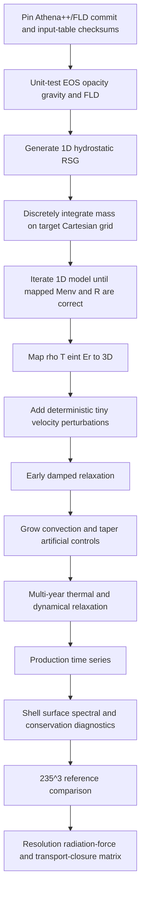
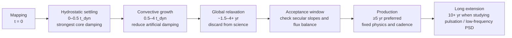

# Reproducing Freytag–Chiavassa Star-in-a-Box Red-Supergiant Simulations in Athena++ with FLD

## Executive summary

The most defensible reproduction target is **Chiavassa et al. (2011) model `st35gm03n07`**, because it gives a compact, quantitative specification of the canonical CO5BOLD red-supergiant calculation: a \(235^3\) Cartesian star-in-a-box grid with \(\Delta x=8.6\,R_\odot\), a \(12\,M_\odot\) prescribed gravitational mass, an envelope mass of about \(3\,M_\odot\), gray radiative transfer, \(L\simeq 9.19\times10^4\,L_\odot\), \(R\simeq830\,R_\odot\), \(T_{\rm eff}\simeq3487\) K, and \(\log g\simeq-0.335\). The simulations use a smoothed spherical gravitational potential, central volumetric energy injection, core drag, an H/He/H\(_2\) tabulated EOS, PHOENIX+OPAL opacity tables, open boundaries on all six faces, and short-characteristics radiative transfer. citeturn11view1turn11view2turn12view0

For Athena++, I recommend **not** starting from Goldberg et al.'s spherical-polar RSG configuration. Goldberg, Jiang & Bildsten used Athena++ in a partial spherical envelope with an inner radial boundary, self-gravity of the simulated envelope, and angle-dependent discrete-ordinates radiation transport. That calculation is extraordinarily useful as an independent RSG benchmark, but geometrically and physically it is not the Freytag/Chiavassa star-in-a-box experiment. The closest reproduction is instead to combine Athena++'s Cartesian Godunov hydrodynamics with the CO5BOLD full-cube geometry, smoothed central potential, internal heating region, core damping, realistic EOS/opacities, and your FLD module. citeturn21view1turn21view4

The resulting calculation should be regarded as a **physics-level/statistical reproduction, not a bitwise reproduction**. Three important ingredients are not fully specified in the published papers: the precise CO5BOLD opacity/EOS tables, the detailed spatial profile and numerical implementation of central heating, and the exact core-drag coefficient/profile. Moreover, replacing short-characteristics transport by FLD changes the closure precisely where RSG surface physics is most interesting, around \(\tau\sim1\) and in the optically thin atmosphere. The publications are nevertheless sufficient to reproduce the global experimental design and to test whether the same statistical RSG state emerges. citeturn11view1turn14view1turn14view3

The baseline should therefore be split into two Athena++ branches:

| Branch | Purpose | Radiation momentum |
|---|---|---|
| **`co5bold_legacy_fld`** | Closest controlled experiment against `st35gm03n07` | Off, or as close as your FLD architecture permits |
| **`full_rhd_fld`** | Preferred physical Athena++ calculation | On, including radiation force/work consistently |

This distinction matters. The RSG CO5BOLD formulation used by Chiavassa does not put a radiation-force term into the hydrodynamic momentum equation, whereas the Goldberg Athena++ calculations couple radiation energy **and momentum** and find radiation pressure supplying a substantial fraction of the deep-envelope support. The 2024 review identifies this as one reason the CO5BOLD and Athena++ entropy profiles differ. citeturn12view0turn21view1turn5view2

For the historical baseline, the published \(235^3\) grid implies a cube approximately

\[
L_{\rm box}=235(8.6R_\odot)\simeq2021R_\odot,
\]

hence \(-1010.5R_\odot<x,y,z<1010.5R_\odot\). With \(R_\star\simeq830R_\odot\), the box edge is about \(2.44R_\star\), each face is \(1.22R_\star\) from the center, and the corners extend to about \(2.11R_\star\). This geometry is consistent with the motivation for flattening the gravitational potential outside roughly \(1.2R_\star\): without it, the far corners develop extremely low densities. These box dimensions are derived directly from the `st35gm03n07` resolution and cell size reported by Chiavassa et al. citeturn11view2turn14view1

A serious production programme should not consist of one run. I recommend an exact historical \(235^3\) run plus a resolution series, an FLD-versus-angular-transport experiment at reduced resolution, and a radiation-force toggle. This is especially important because FLD is guaranteed to approach diffusion correctly at large optical depth but does **not** retain enough angular information to reproduce general optically thin transport or shadows. Levermore–Pomraning FLD limits the flux to causal values, but the flux direction remains tied to \(-\nabla E_r\); angular transport methods demonstrably outperform FLD in multidimensional shadowing tests. citeturn23search7turn23academia8turn23search2

My recommended end-to-end programme is therefore:

**1D hydrostatic star → discrete \(235^3\) Cartesian mapping → weak seeded perturbations → strongly controlled early relaxation → several years of convective development → at least several additional years of statistically stationary production → shell, surface, temporal and spectral diagnostics → comparison against Chiavassa statistics and a matched angular-transport control.**

Chiavassa's RSG sequence required years to forget its regular initial pattern; early radius drift led them to exclude the first several years from parts of the analysis. Freytag et al.'s later global AGB calculations similarly report a few-year initial adjustment and then decades-long integrations, while Goldberg et al.'s Athena++ RSG envelopes did not reach their adopted steady state until roughly 4000–4500 days. Long statistical sampling is therefore part of the physics experiment rather than optional bookkeeping. citeturn10view0turn18view0turn21view3


## Reference target and prioritized bibliography

The literature separates naturally into four roles: **the quantitative target** (`st35gm03n07`), **the numerical-method specification** of CO5BOLD, **independent Athena++ RSG results**, and **closure/FLD references**.

| Priority | Reference and link | Why it should drive the reproduction |
|---|---|---|
| **Essential** | Chiavassa, Freytag, Masseron & Plez (2011), *Radiative hydrodynamics simulations of red supergiant stars IV: Gray versus non-gray opacities*. [DOI](https://doi.org/10.1051/0004-6361/201117463), [arXiv](https://arxiv.org/abs/1109.3619) | The single most important target paper. It tabulates `st35gm03n07`, documents the Cartesian star-in-a-box setup, EOS, open boundaries, smoothed gravity, core source/drag, short-characteristics radiation and gray/non-gray treatments. citeturn11view1turn11view2 |
| **Essential** | Chiavassa, Plez, Josselin & Freytag (2009), *RHD simulations of red supergiant stars I*. [DOI](https://doi.org/10.1051/0004-6361/200911780), [arXiv](https://arxiv.org/abs/0907.1860) | Gives the canonical RSG morphology and temporal scales: a few giant cells of order \(400\!-\!500R_\odot\), smaller \(50\!-\!100R_\odot\) surface structures, and quantitative luminosity/radius/temperature evolution of `st35gm03n07`. citeturn10view0turn20search0 |
| **Essential** | Freytag, Steffen, Ludwig et al. (2012), *Simulations of stellar convection with CO5BOLD*. [arXiv](https://arxiv.org/abs/1110.6844) | Main numerical-method paper: global star-in-box geometry, exact smoothed-potential family, core heating/drag, recommended 1D-to-3D initialization, open boundaries, EOS, viscosity and short-characteristics methodology. citeturn14view0turn14view1turn14view3 |
| **Essential comparison** | Chiavassa, Kravchenko & Goldberg (2024), *Signatures of convection in the atmospheres of cool evolved stars*. [DOI](https://doi.org/10.1007/s41115-024-00020-w) | The clearest modern side-by-side discussion of CO5BOLD and Athena++ RSG calculations, including geometry, radiation algorithms, radiation pressure and differing entropy structures. citeturn20search5turn21view4 |
| **Essential Athena++ comparison** | Goldberg, Jiang & Bildsten (2022), *Numerical Simulations of Convective 3-Dimensional Red Supergiant Envelopes*. [arXiv](https://arxiv.org/abs/2110.03261) | Independent Athena++ RSG benchmark: Godunov hydro, explicit angular radiation, self-gravity, convective plume scales, turbulent/radiation pressure, relaxation criteria and luminosity variability. citeturn17academia4turn21view1turn21view3 |
| **High** | Freytag, Steffen & Dorch (2002), *Spots on the surface of Betelgeuse*. [DOI](https://doi.org/10.1002/1521-3994%28200208%29323%3A3%2F4%3C213%3A%3AAID-ASNA213%3E3.0.CO%3B2-H) | Historical star-in-a-box paper and useful source for the exact analytic smoothed gravitational potential and the rationale for replacing the unresolved core with central energy injection. citeturn20search3turn9view0 |
| **High** | Freytag, Liljegren & Höfner (2017), *Global 3D radiation-hydrodynamics models of AGB stars*. [arXiv](https://arxiv.org/abs/1702.05433) | Updated global-model workflow: 1D initial states, reuse/refinement of relaxed 3D predecessors, several-year initial adjustment, long integrations and monitoring of luminosity/central density. Particularly useful for designing the relaxation procedure. citeturn18view0 |
| **High, atmospheric phenomenology** | Freytag, Höfner, Aringer & Chiavassa (2024), *Dimming events of evolved stars due to clouds of molecular gas*. [arXiv](https://arxiv.org/abs/2411.17561) | Modern CO5BOLD global simulations showing how convection, pulsation and shocks produce highly structured extended atmospheres; useful as a later-stage morphology check, not as the `st35gm03n07` parameter target. citeturn22academia4 |
| **Supporting independent star-in-box** | Dorch (2004), *Magnetic activity in late-type giant stars*. [arXiv](https://arxiv.org/abs/astro-ph/0403321) | Independent Pencil-Code star-in-box Betelgeuse calculation. Its thermodynamics/radiative treatment are too simplified for the baseline, but its spatial power-spectrum analysis and large-scale convective structures provide useful independent diagnostics. citeturn19view0turn19view2 |
| **FLD foundation** | Levermore & Pomraning (1981), *A Flux-Limited Diffusion Theory*. [ADS paper](https://adsabs.harvard.edu/pdf/1981ApJ...248..321L) | Foundational FLD closure and causal thick/thin limiting behavior. citeturn23search7 |
| **FLD verification** | Turner & Stone (2001), *A Module for Radiation Hydrodynamic Calculations With ZEUS-2D Using Flux-Limited Diffusion*. [arXiv](https://arxiv.org/abs/astro-ph/0102145) | Particularly useful for FLD validation tests and for understanding the angular limitations of the closure. citeturn23search2 |
| **Transport-vs-FLD verification** | Hayes & Norman (2003), *Beyond Flux-Limited Diffusion*. [arXiv](https://arxiv.org/abs/astro-ph/0207260) | Contains multidimensional shadow and radiation-hydrodynamic tests demonstrating where angular closures improve on FLD. citeturn23academia8 |
| **Athena++ implementation** | Stone, Tomida, White & Felker (2020), *The Athena++ Adaptive Mesh Refinement Framework*. [DOI](https://doi.org/10.3847/1538-4365/ab929b) | Framework, Godunov solvers, general EOS support and task-based implementation. citeturn23academia9turn23search1 |
| **Reproducible code release** | Athena++ development team, v24.0. [Zenodo](https://doi.org/10.5281/zenodo.11660592) | As of October 2026, v24.0 remains the latest tagged public Athena++ release; the repository provides HLLC/LHLLC/Roe choices, general tabular EOS support and radiation modules. Your FLD fork should nevertheless be pinned by exact commit rather than described simply as “v24.0”. citeturn24search0turn24search1turn17search0 |

Dorch should deliberately be lower in priority than Chiavassa/Freytag. Its \(128^3\), \(\Delta x=15R_\odot\) Betelgeuse model used a simplified constant-opacity/Newtonian surface-cooling treatment whose cooling temperature was much hotter than Betelgeuse's actual effective temperature. It is consequently valuable as an independent demonstration that star-in-a-box convection develops strong low-wavenumber power, but not as an RHD thermal benchmark. citeturn19view1turn19view2

Freytag et al. (2017) is technically an AGB rather than RSG paper, but it is important for reproducibility procedure. The later CO5BOLD models were generally generated by modifying an already relaxed 3D predecessor—refining/coarsening its grid, changing the box, gradually changing luminosity, or gradually altering envelope mass—and the models were evolved for much longer than the initial few-year transient. That strategy should become your second-generation workflow after the first Athena++ RSG baseline exists. citeturn18view0


## Physics and numerical architecture

The key design decision is to reproduce the **CO5BOLD physical experiment**, not to reproduce the geometry of Goldberg's Athena++ calculation. The latter covers a large spherical-polar portion of an RSG envelope with radial inner and outer boundaries; the former evolves the entire star through the Cartesian origin. citeturn21view1turn21view4

| Component | CO5BOLD RSG reference | Goldberg Athena++ | Recommended Athena++/FLD reproduction |
|---|---|---|---|
| Geometry | Full Cartesian cube, star centered inside box; uniform cells. citeturn11view1 | Spherical polar; \(128\) in \(\theta\), \(256\) in \(\phi\), partial hemisphere and logarithmic \(r\). citeturn21view1turn6view3 | **Full Cartesian cube**, uniform baseline |
| Hydro | Finite volume, directional splitting, approximate Roe solver. citeturn11view1turn21view4 | Athena++ Godunov hydro. citeturn21view1 | HLLC as robust default; Roe sensitivity run to approach CO5BOLD numerically |
| EOS | Table including H/H\(^+\), H\(_2\), He ionization states and representative metal contribution. citeturn11view1 | Fixed-\(\mu\) ideal gas in the published RSG run; authors note shortcomings below \(10^4\) K. citeturn21view1turn21view3 | **General tabular EOS mandatory**; do not use ideal-\(\gamma\) baseline |
| Radiation | Short characteristics; gray Rosseland or opacity bins; LTE. citeturn11view1turn11view2 | Time-dependent angular discrete ordinates; 120 angles; energy and momentum coupling. citeturn21view1 | User FLD; gray first; separately toggle radiation momentum |
| Low-\(T\) opacity | PHOENIX-like molecular opacity, merged near \(12\,000\) K with high-\(T\) OPAL. citeturn11view1turn18view0 | OPAL Rosseland/Planck absorption plus scattering. citeturn21view1 | PHOENIX/COMA-quality low-\(T\)+OPAL high-\(T\), with \(\kappa_R\) and preferably \(\kappa_P\) |
| Gravity | Fixed externally prescribed spherical potential, softened at center and flattened at large radius. citeturn9view0turn14view1 | Core mass plus evolving envelope mass. citeturn21view1 | **Fixed CO5BOLD potential first**; self-gravity is a separate experiment |
| Core | Volume energy source inside smoothed core; drag suppresses dipolar flow. citeturn11view1turn18view0 | Radial inner boundary, hot-plate or fixed-luminosity source. citeturn21view1 | Volume heating + configurable core drag |
| Outer hydro BC | Same open BC on all six cube faces. citeturn11view1turn21view4 | Radial outer BC; periodic angular directions. citeturn5view1 | Six identical user-defined open boundaries |
| Radiation pressure | Not part of the historical Chiavassa momentum equation. citeturn12view0 | Included; substantial in deep RSG envelope. citeturn17academia4turn21view1 | Legacy off + physical on, as two documented branches |

**Baseline numerical parameters.** The values below should be placed in one canonical machine-readable parameter file and never duplicated as hard-coded constants in the problem generator.

| Parameter | Historical target | Recommended implementation |
|---|---:|---|
| Model | `st35gm03n07` | same identifier plus `_athena_fld` |
| \(M_{\rm pot}\) | \(12\,M_\odot\) | 12 |
| \(M_{\rm env}\) | \(3.0\,M_\odot\) | discrete-grid target 3.0 |
| \(L_\star\) | \(91\,932\pm1\,400\,L_\odot\) | \(L_{\rm heat}=91\,932L_\odot\) initially |
| \(R_\star\) | \(830.0\pm2.0R_\odot\) | initial HSE target 830 |
| \(T_{\rm eff}\) | \(3487\pm12\) K | initial target 3487 |
| \(\log g\) | \(-0.335\pm0.002\) | diagnostic, not separately tuned |
| Grid | \(235^3\) | exact baseline |
| Cell width | \(8.6R_\odot\) | exact baseline |
| Box side | derived \(\simeq2021R_\odot\) | \(\simeq1.4060\times10^{14}\) cm |
| Half width | derived \(1010.5R_\odot\) | \(\simeq7.0300\times10^{13}\) cm |
| Gravity \(r_0\) | typically \(\sim0.2R_\star\) | start at \(166R_\odot\) |
| Gravity \(r_1\) | typically \(\sim1.2R_\star\) | start at \(996R_\odot\) |
| Opacity | gray | gray FLD baseline |
| Rotation | none | none |
| Magnetic field | none | none |
| Dust | none | none |

The stellar quantities and grid entries above come directly from Chiavassa et al.'s table; \(L_{\rm box}\), half-width and \(r_{0,1}\) in solar-radius units are derived from those reported values and the usual \(r_0\simeq0.2R_\star,\ r_1\simeq1.2R_\star\) smoothing choices. citeturn11view2turn12view0turn9view0

The historical gravitational potential should be implemented directly rather than approximated with Plummer softening. Freytag's star-in-box prescription is

\[
\Phi(r)=
-\frac{G M_{\rm pot}}
{\left[
r_0^4+
\dfrac{r^4}{\sqrt{1+(r/r_1)^8}}
\right]^{1/4}} .
\]

The \(r_0\) term regularizes the center; the \(r_1\) term makes the potential asymptotically flat at very large radius. The exact functional form appears in the original Freytag formulation and subsequent CO5BOLD descriptions. citeturn9view0turn14view1

For code, use the **analytic acceleration**, not a finite-difference derivative of \(\Phi\). Defining

\[
A(r)=r_0^4+\frac{r^4}{\sqrt{1+(r/r_1)^8}},\qquad
B(r)=1+(r/r_1)^8 ,
\]

differentiation gives

\[
g_r=-\frac{d\Phi}{dr}
=-GM_{\rm pot}\,
r^3 A^{-5/4}B^{-3/2}.
\]

This has the desirable limits \(g_r\rightarrow0\) at the origin, approximately \(-GM/r^2\) for \(r_0\ll r\ll r_1\), and rapid flattening outside \(r_1\). This derivative is an algebraic consequence of Freytag's published potential. citeturn9view0

**EOS is not optional fidelity.** The large opacity/ionization transitions in an RSG occur precisely where hydrogen recombination, molecule formation and rapidly varying heat capacity matter. CO5BOLD's table explicitly handles H ionization, H\(_2\), and helium ionization; Goldberg's paper notes that its fixed-\(\mu\) gas approximation can overestimate the gas pressure in cool outer layers. Athena++ supports `general/eos_table`, so the reproduction should use that machinery—or your fork's equivalent—from the outset. citeturn11view1turn21view3turn17search0

The 1D initial-model generator and Athena++ must use the **same table and interpolation convention**. In particular, Codex should provide round-trip tests such as

\[
(\rho,T)\rightarrow(e,P)\rightarrow T
\]

over every density-temperature decade traversed by the model, and production should abort rather than silently clamp outside the EOS table.

**Opacity.** For the gray baseline, \(\kappa_R(\rho,T)\) should reproduce the PHOENIX/OPAL merge near \(T\sim12\,000\) K as closely as practical. CO5BOLD's RSG opacity bump around the H-ionization region is dynamically important; Freytag's later models retained the same basic low-temperature/high-temperature merger. citeturn11view1turn11view3turn18view0

For a two-temperature FLD implementation, use

\[
{\bf F}_r=-D\nabla E_r,\qquad
D=\frac{c\lambda}{\rho\kappa_R},
\]

with \(\kappa_R\) for transport and a Planck mean \(\kappa_P\) for matter-radiation thermal exchange,

\[
Q_{\rm rad}
\simeq c\rho\kappa_P\left(E_r-a_rT^4\right),
\]

with opposite signs in the gas and radiation equations. Goldberg's angular-transfer formulation likewise distinguishes Rosseland and Planck absorption means. citeturn21view1

For the Levermore–Pomraning-style limiter commonly used in FLD,

\[
R_{\rm FLD}
=\frac{|\nabla E_r|}
{\rho\kappa_R E_r},
\]

and the closure must obey

\[
\lambda\rightarrow\frac13\quad(R_{\rm FLD}\rightarrow0),
\qquad
\lambda\rightarrow\frac1{R_{\rm FLD}}\quad(R_{\rm FLD}\rightarrow\infty),
\]

so that the optically thick diffusion limit is recovered and \(|{\bf F}_r|\rightarrow cE_r\) rather than exceeding the causal free-streaming flux. citeturn23search7

Do **not** force the Levermore–Pomraning analytic limiter into your code if your implemented FLD intentionally uses another limiter. Codex should instead expose the limiter name in metadata and unit-test whichever closure is actually used for the two asymptotic limits and for

\[
f_{\rm red}\equiv\frac{|{\bf F}_r|}{cE_r}\le1.
\]

**Central heating.** The papers specify an internal-energy source in the softened central region that supplies the stellar luminosity, but do not provide enough information to reconstruct every implementation detail. citeturn11view1turn18view0 I therefore recommend

\[
\dot e_{\rm heat}({\bf x})
=C_h\,w_h(r),
\qquad
C_h=\frac{L_{\rm in}}
{\sum_{\rm cells} w_h(r)\,\Delta V},
\]

where the normalization is done on the **actual discrete Cartesian mesh**. Start with \(w_h=1\) for \(r<r_0\) and zero outside; additionally implement a smooth profile such as \(w_h=\exp[-(r/r_h)^6]\) as a sensitivity option. The discrete normalization should recover \(L_{\rm in}\) to roundoff independent of resolution.

**Core drag.** CO5BOLD applies drag only in the core to suppress dipolar flows through the whole star, but the papers do not expose a uniquely reproducible damping coefficient. citeturn11view1turn18view0 Make this ambiguity explicit rather than burying it in code. I recommend exposing at least

\[
{\bf a}_{\rm drag}
=-w_d(r)\frac{\bf v}{\tau_d}
\]

and a less intrusive “core-COM” mode that damps only the weighted core bulk velocity. As an engineering starting point—not a published `st35gm03n07` value—use \(\tau_d\sim0.5t_{\rm dyn}\) during early relaxation and weaken it gradually thereafter. For \(M=12M_\odot,\ R=830R_\odot\),

\[
t_{\rm dyn}=\sqrt{\frac{R^3}{GM}}\simeq127\ {\rm d}.
\]

The physically meaningful acceptance test is preferable to the nominal coefficient: once relaxed, the time-averaged drag power should be negligible compared with \(L_\star\), while the unphysical core translational/dipolar motion remains small.

**Open hydrodynamic boundaries.** CO5BOLD typically uses two ghost layers in which velocities and specific internal energy are continued outward and density declines exponentially according to a prescribed fraction of the local hydrostatic scale height. citeturn11view1 This deserves a custom Athena++ boundary function on all six faces rather than a generic zero-gradient `outflow` flag. Do not clamp inward velocity in the historical-emulation run unless stability forces you to; doing so changes the meaning of “open.”

For FLD radiation, a zero-gradient \(E_r\) outer boundary is usually inappropriate because it tends to suppress the outgoing diffusive gradient. Use your closure's vacuum/Marshak or equivalent outgoing boundary treatment and verify it with a static radiating atmosphere. The required numerical criterion is that moving the boundary moderately farther out should not materially change \(L_{\rm out}\), \(R_\star\), or \(T_{\rm eff}\).

**Resolution should be separated into reproduction and convergence tracks.** The \(401^3\) model in Chiavassa et al. (2011) is a different \(6M_\odot\), smaller-radius star and should not be presented as a resolution convergence run of `st35gm03n07`. citeturn11view2 A useful same-physics sequence is instead:

| Track | Grid | Same \(2021R_\odot\) box | Purpose |
|---|---:|---:|---|
| cheap commissioning | \(117^3\) | \(\Delta x\simeq17.3R_\odot\) | code/debug/relaxation workflow |
| historical | **\(235^3\)** | **\(8.6R_\odot\)** | main CO5BOLD comparison |
| convergence | \(470^3\) | \(4.3R_\odot\) | factor-two cell convergence |
| aggressive convergence | \(940^3\) | \(2.15R_\odot\) | surface/shock convergence if desired |

Athena++ divides the root grid into MeshBlocks, and its mesh implementation computes the block decomposition from the global and block dimensions. citeturn25search1 Since \(235=5\times47\), \(47^3\) blocks are an attractive starting decomposition for the historical grid **if your exact branch accepts odd block dimensions**; Codex should verify this with a mesh-only startup test rather than assume it.

For hydro, start at `cfl_number = 0.3`. CO5BOLD used several radiation updates within a hydrodynamic step, with individual radiation updates of order hundreds of seconds in the published RSG setup. citeturn11view1turn11view3 For an explicit FLD solver, also enforce the diffusion stability condition schematically

\[
\Delta t_{\rm diff}
\lesssim
\frac{\Delta x^2}{2dD_{\max}}
\quad (d=3),
\]

in addition to the hydro CFL. For an implicit FLD solver, the hydro CFL can usually set the global step, but convergence tolerances and the allowed fractional matter/radiation energy change per solve become part of the reproducibility specification.


## Reproducibility workflow and Codex deliverables

The most important instruction for Codex is: **first inspect your FLD fork, then write the pgen**. Athena++'s public configuration interface recognizes `--prob`, Cartesian coordinates, `general/eos_table`, Roe/HLLC/LHLLC choices, MPI, OpenMP and HDF5, while v24.0 also contains public radiation modules. Your custom FLD interface may differ, so Codex must not silently substitute the stock Athena++ discrete-ordinates radiation module for your FLD implementation. citeturn17search0turn24search0



**Stepwise Codex checklist**

1. **Create an immutable reproducibility manifest before editing.** Record the Athena++ fork URL, exact Git commit, whether the worktree is dirty, compiler and MPI versions, configuration arguments, FLD compile flags, EOS/opacity file SHA-256 checksums and the random perturbation seed. Athena++ itself encourages version-specific software citation through its tagged releases and Zenodo records. citeturn24search1turn24search2

2. **Implement and independently test the Freytag potential.** Provide `Phi(r)` and analytic `g(x,y,z)` routines. Test center regularity, the intermediate point-mass limit, outer flattening, spherical symmetry and analytic-vs-finite-difference derivatives. The pgen must never contain a Plummer substitute. citeturn9view0turn14view1

3. **Build a standalone 1D hydrostatic generator using the production EOS and opacity.** Solve

   \[
   \frac{dP}{dr}=-\rho\,\frac{d\Phi}{dr}
   \]

   with an approximately adiabatic deep envelope and a gray \(T(\tau)\) atmosphere as the initial outer stratification. This follows the published CO5BOLD initialization concept: hydrostatic sphere, gray atmospheric stratification near the photosphere, adiabatic optically thick layers. citeturn11view2

   Also integrate

   \[
   M_{\rm env}=4\pi\int \rho r^2dr
   \]

   and iterate the deep-envelope entropy/density normalization until the mapped model approaches \(3M_\odot\), \(R\simeq830R_\odot\), and the intended photospheric temperature.

4. **Make the mapping discretization-aware.** Sample the 1D model using \(r=(x^2+y^2+z^2)^{1/2}\) at every Athena++ cell, then calculate the mass by the actual Cartesian sum

   \[
   M_{\rm grid}=\sum \rho_{ijk}\Delta V .
   \]

   Feed the discrepancy back into the **1D generator** rather than simply multiplying all 3D densities by an arbitrary correction. This minimizes a large artificial hydrostatic transient.

5. **Initialize radiation consistently.** For LTE initialization, use \(E_r=a_rT^4\) where compatible with your FLD formulation. Initialize every cell from a valid EOS state; forbid NaNs, opacity/EOS table clipping, negative pressure, or negative radiation energy before the first Athena++ step.

6. **Seed convection reproducibly.** Freytag recommends starting from a hydrostatic model with small velocity fluctuations if a relaxed predecessor is unavailable; later calculations preferentially reuse a related 3D model. citeturn14view1turn18view0 For the first Athena++ run, add a deterministic zero-net-momentum perturbation at roughly \(\mathcal M\sim10^{-4}-10^{-3}\). Record the RNG algorithm and seed. Avoid a perturbation tied to the Cartesian axes.

7. **Implement central heating with discrete normalization.** Require a unit test that the volume sum equals \(L_{\rm in}\) to near machine precision. Output `L_heat` as a history variable on every diagnostic step.

8. **Implement core drag separately from gravity/heating.** Output both the momentum removed and `P_drag`; do not allow an invisible numerical sink. Make its radial profile, timescale and temporal taper input parameters because the published literature does not uniquely fix them. citeturn11view1turn18view0

9. **Implement all six CO5BOLD-like open hydrodynamic boundaries and the FLD vacuum boundary.** Test every face separately with a pulse leaving the domain. Six-face symmetry is essential because the CO5BOLD global model treats every surface equivalently. citeturn11view1turn21view4

10. **Run a low-resolution \(117^3\) commissioning star first.** This is not for science; it should exercise the complete source-term, EOS, opacity, radiation, restart and analysis path for multiple dynamical times. Do not begin the \(235^3\) reference until this run satisfies energy, positivity and boundary tests.

11. **Run `st35gm03n07` at \(235^3\)** with all parameters frozen in a versioned input file. Treat the first roughly four years as relaxation unless objective diagnostics demonstrate that a longer interval is required. Chiavassa found important early secular drift and excluded the early part of the evolution from quantitative analysis. citeturn10view0

12. **Only after the reference run, branch the experiment.** Run \(470^3\), radiation-force on/off, alternative drag profile, larger box, and a transport-closure comparison. This ordering makes it possible to attribute differences to one change rather than to an uncontrolled collection of implementation choices.

The pgen file tree I would ask Codex to produce is:

```text
src/pgen/rsg_star_in_box.cpp

inputs/rsg/
    athinput.st35gm03n07_fld
    athinput.st35gm03n07_fld_117
    athinput.st35gm03n07_fld_470
    athinput.rsg_validation

tools/rsg/
    make_hse_model.py
    verify_hse_model.py
    map_check.py
    rsg_diagnostics.py
    rsg_spectra.py
    make_surface_maps.py

scripts/
    configure_rsg.sh
    run_rsg.sh
    restart_rsg.sh
    capture_manifest.sh

tests/rsg/
    test_gravity.py
    test_eos_roundtrip.py
    test_opacity.py
    test_heating_normalization.py
    test_fld_limits.py
    test_hydrostatic_mapping.py
    test_restart_reproducibility.py

data/
    eos/MANIFEST
    opacity/MANIFEST

repro/
    README.md
    manifest.yaml
    acceptance.yaml
```

In stock Athena++ the standard pattern is to put the selected problem generator in `src/pgen/<name>.cpp`; `configure.py --prob=<name>` selects it, and user boundary functions can be enrolled in `Mesh::InitUserMeshData`. The official problem generators demonstrate `Mesh::InitUserMeshData`, `MeshBlock::ProblemGenerator` and per-face `EnrollUserBoundaryFunction` usage. citeturn17search0turn25search0

A pgen architecture should look conceptually like this; Codex must adapt function signatures to your fork rather than paste the skeleton blindly:

```cpp
// rsg_star_in_box.cpp -- architecture, not drop-in code

namespace {
struct RSGParams {
  Real gm;
  Real r0, r1;
  Real luminosity;
  Real drag_tau;
  Real drag_radius;
  bool radiation_force;
  uint64_t perturb_seed;
};

RSGParams pars;

Real Potential(Real r);
void GravityVector(Real x, Real y, Real z,
                   Real &gx, Real &gy, Real &gz);
Real HeatingWeight(Real r);
Real DragWeight(Real r);

// Source terms:
//   external gravity
//   normalized central heating
//   optional core drag
void RSGSource(/* signature required by user's Athena++ fork */);

// Six copies/wrappers around one coordinate-independent open-BC kernel.
void InnerX1(...);
void OuterX1(...);
void InnerX2(...);
void OuterX2(...);
void InnerX3(...);
void OuterX3(...);
}

void Mesh::InitUserMeshData(ParameterInput *pin) {
  // 1. Read all parameters -- no hidden science constants.
  // 2. Read/validate 1D model and table metadata.
  // 3. Enroll source terms.
  // 4. Enroll all six user boundaries.
  // 5. Enroll history diagnostics.
}

void MeshBlock::ProblemGenerator(ParameterInput *pin) {
  // For each Cartesian cell:
  //   r = sqrt(x*x + y*y + z*z)
  //   interpolate rho(r), T(r), e_int(r), E_rad(r)
  //   query production EOS
  //   add deterministic zero-momentum perturbation
  //   initialize gas + FLD variables consistently
}
```

The suggested canonical input block is intentionally verbose. Science parameters should live here rather than in the C++ file.

```ini
<mesh>
nx1 = 235
nx2 = 235
nx3 = 235

x1min = -7.0300485e13
x1max =  7.0300485e13
x2min = -7.0300485e13
x2max =  7.0300485e13
x3min = -7.0300485e13
x3max =  7.0300485e13

ix1_bc = user
ox1_bc = user
ix2_bc = user
ox2_bc = user
ix3_bc = user
ox3_bc = user

# Candidate for the exact 235^3 grid; verify with your Athena++ branch.
<meshblock>
nx1 = 47
nx2 = 47
nx3 = 47

<time>
cfl_number = 0.30

<problem>
model_name          = st35gm03n07_athena_fld
hse_model_file      = data/ic/st35gm03n07_hse.h5

m_pot_msun          = 12.0
m_env_target_msun   = 3.0
luminosity_lsun     = 91932.0
rstar_target_rsun   = 830.0
teff_target_K       = 3487.0

r0_over_rstar       = 0.20
r1_over_rstar       = 1.20

heating_profile     = top_hat
heating_radius_r0   = 1.0

drag_mode           = local
drag_radius_r0      = 1.0
drag_tau_tdyn       = 0.50
drag_taper          = true

perturb_seed        = 350307
perturb_mach        = 1.0e-4

radiation_force     = false

<rsg_eos>
table_file           = data/eos/rsg_eos.h5
abort_on_clamp       = true

<rsg_opacity>
rosseland_file       = data/opacity/kappa_R.h5
planck_file          = data/opacity/kappa_P.h5
abort_on_clamp       = true

<radiation_fld>
# Names below are intentionally mapped to your custom FLD API by Codex.
closure              = levermore_pomraning
implicit             = true
vacuum_boundary      = true
solver_rtol          = 1.0e-8
solver_atol           = 0.0
```

The published values behind the parameter block are those of `st35gm03n07`; the FLD solver tolerances, perturbation amplitude and explicit drag coefficient are reproducibility recommendations rather than quantities claimed to have been used by CO5BOLD. citeturn11view2

The build script should pin the compiler configuration and leave your FLD-specific flag explicit:

```bash
#!/usr/bin/env bash
set -euo pipefail

: "${FLD_CONFIG_FLAGS:?Set FLD_CONFIG_FLAGS for your Athena++ FLD fork}"

git rev-parse HEAD
git status --short

python3 configure.py \
  --prob=rsg_star_in_box \
  --coord=cartesian \
  --eos=general/eos_table \
  --flux=hllc \
  -mpi \
  -omp \
  -hdf5 \
  ${FLD_CONFIG_FLAGS}

make clean
make -j"${BUILD_JOBS:-16}"
```

Those standard configuration names are supported by the current Athena++ configuration script; HLLC, LHLLC and Roe are all available choices. citeturn17search0turn24search0 A separate build should use `--flux=roe` as a numerical-method sensitivity test because CO5BOLD's hydro solver is Roe-like. citeturn11view1

A minimal production run wrapper should make each run self-documenting:

```bash
#!/usr/bin/env bash
set -euo pipefail

INPUT="${1:?usage: run_rsg.sh INPUT RUN_DIR}"
RUN_DIR="${2:?usage: run_rsg.sh INPUT RUN_DIR}"
NPROC="${NPROC:-128}"

mkdir -p "${RUN_DIR}"

cp "${INPUT}" "${RUN_DIR}/athinput"
git rev-parse HEAD > "${RUN_DIR}/git_commit.txt"
git diff --binary > "${RUN_DIR}/git_diff.patch"
sha256sum "${INPUT}" > "${RUN_DIR}/input.sha256"

# Add EOS/opacity table hashes here.
sha256sum data/eos/* data/opacity/* \
  > "${RUN_DIR}/physics_tables.sha256"

mpirun -n "${NPROC}" ./bin/athena \
  -i "${RUN_DIR}/athinput" \
  > "${RUN_DIR}/stdout.log" 2> "${RUN_DIR}/stderr.log"
```

For the first successful relaxed Athena++ model, save a high-quality restart snapshot and follow the later Freytag strategy: new resolutions and nearby stellar parameters can then be generated by controlled interpolation or gradual parameter adjustment rather than paying the full hydrostatic-start transient every time. Freytag et al. explicitly used predecessor 3D models this way in their later global sequence. citeturn18view0


## Relaxation, diagnostics and validation

A star-in-a-box model is not “relaxed” merely because it stops crashing. The original hydrostatic-to-3D CO5BOLD start initially shows regular grid-linked convection; cells merge, symmetry is lost, and only after several years does the model develop the irregular global flow used for science. citeturn11view2turn5view0 Goldberg's completely different Athena++ geometry independently demonstrates the same general point: convective velocities settle substantially later than convection first appears, and their two RSG runs were treated as steady only after roughly 4000 and 4500 days. citeturn6view0turn21view3

A useful simulation-time schedule is:



With the `st35gm03n07` parameters, \(t_{\rm dyn}\simeq127\) days, so several dynamical times are much shorter than the full multiyear thermal/convective relaxation. The recommendation to discard about the first four years is anchored by the published RSG evolution, while the subsequent production length is deliberately more conservative because large cells themselves live for years. citeturn10view0

During the first phase, keep the radiation, gravity and heating active; otherwise you are relaxing toward the wrong equilibrium. Use a conservative hydro CFL and relatively strong core damping. After initial grid-mapping oscillations decay, let the velocity perturbations grow into convection and taper any **temporary** damping that is not part of the intended production model.

Do not manually force the final stellar radius to 830 \(R_\odot\) after convection begins. In the published simulations the final radius, \(T_{\rm eff}\) and luminosity are emergent time-dependent quantities around the intended model parameters. citeturn11view2turn18view0

For the scalar time series, save at least daily-to-few-day cadence. Freytag's later global models saved compressed “fine” diagnostics about every three days, while full 3D snapshots can be substantially less frequent. citeturn18view0 A sensible no-compute-limit strategy is scalar history every \(0.25\!-\!1\) day, reduced shell profiles every \(1\!-\!3\) days, full 3D state every \(10\!-\!25\) days, and restart files every \(10\!-\!30\) days.

**The diagnostics should include quantities that distinguish energy transport from mere morphology.**

The instantaneous shell radiative luminosity is

\[
L_{\rm rad}(r)
=\oint {\bf F}_r\cdot d{\bf A},
\]

and the total radial energy transport should additionally include enthalpy/internal-energy advection, kinetic-energy flux, gravitational-energy transport as appropriate to your conservative formulation, and any other explicit term. Goldberg et al. used the radial constancy of the time-averaged total luminosity as a central steady-state test. citeturn5view5

Track separately:

\[
L_{\rm heat},\quad
L_{\rm rad},\quad
L_{\rm enthalpy},\quad
L_{\rm kin},\quad
L_{\rm grav},\quad
P_{\rm drag},\quad
\frac{dE_{\rm domain}}{dt}.
\]

The global budget should close according to

\[
\frac{dE}{dt}
\simeq
L_{\rm heat}
-
L_{\rm boundary}
+
P_{\rm gravity/external}
+
P_{\rm drag}
\]

using the energy convention actually implemented by your code. This should be a regression diagnostic, not something reconstructed after the simulation.

For direct comparison with Chiavassa, implement their stellar-radius convention rather than relying solely on a \(\tau=2/3\) surface. Their model radius is defined using shell-averaged temperature and luminosity through the Stefan–Boltzmann relation

\[
\frac{L(R)}{4\pi R^2}
=
\sigma_{\rm SB}T(R)^4,
\]

and \(T_{\rm eff}\) is associated with this radius. citeturn10view0 Also report a second, independent radius derived from the Rosseland optical-depth surface, because the RSG photosphere is strongly corrugated.

Every reduced snapshot should contain radial profiles of at least

\[
\langle\rho\rangle,\;
\langle T\rangle,\;
\langle P_{\rm gas}\rangle,\;
\langle P_{\rm rad}\rangle,\;
\langle s\rangle,\;
v_{r,\rm rms},\;
v_{t,\rm rms},\;
\mathcal M_{\rm rms},\;
\kappa_R,\;
\tau_R,\;
\frac{F_{\rm rad}}{F_{\rm tot}},\;
\frac{P_{\rm turb}}{P_{\rm gas}+P_{\rm rad}}.
\]

This is particularly useful because Goldberg finds a nearly flat deep entropy profile and significant radiation-pressure/turbulent support, whereas the 2024 review notes a systematic entropy-structure difference from the CO5BOLD RSGs. citeturn5view2turn21view4

For convection morphology, Chiavassa et al. find two important characteristic scales: long-lived giant structures around \(400\!-\!500R_\odot\), plus smaller \(50\!-\!100R_\odot\) surface structures with lifetimes of months to roughly a year. citeturn10view0 Do not assess this by eye alone.

Interpolate a chosen surface—preferably \(\tau_R=1\), bolometric emergent-flux surface, or a postprocessed intensity surface—onto an equal-area angular grid and compute spherical-harmonic power

\[
C_\ell
=\frac{1}{2\ell+1}
\sum_m |a_{\ell m}|^2.
\]

With the rough relation \(s\sim\pi R/\ell\), a \(400\!-\!500R_\odot\) feature at \(R\simeq830R_\odot\) corresponds very approximately to \(\ell\sim5\!-\!7\), while \(50\!-\!100R_\odot\) structures correspond to \(\ell\sim25\!-\!50\). These should be interpreted as scale ranges, not literal predicted spectral peaks.

Also compute a 3D or shell-based kinetic-energy spectrum. Dorch's independent Betelgeuse star-in-box model found power strongly concentrated toward large convective scales, illustrating why a power spectrum is a useful cross-code metric even though its thermal setup should not be used quantitatively. citeturn19view1

For temporal variability, calculate PSDs of

\[
L(t),\quad R(t),\quad T_{\rm eff}(t),\quad
\langle v_r\rangle_{\rm shell}(t),
\]

using the same detrending and Welch-segment choices for every simulation. Save the exact analysis parameters in YAML. Also calculate autocorrelation times for \(v_r\), luminosity and surface maps. Goldberg reports characteristic plume-correlation times of hundreds of days in its Athena++ RSG models and only a few-percent RMS luminosity variability once statistically steady. These are useful order-of-magnitude checks, not acceptance targets for the different `st35gm03n07` star. citeturn6view0turn17academia4

Because FLD does not evolve the specific intensity \(I({\bf n})\), a raw \(E_r\) map is **not** equivalent to a Chiavassa synthetic stellar image. For surface-convection comparison, postprocess selected snapshots with a formal ray solution through the frozen atmosphere, ideally using the same underlying opacity data. Chiavassa's original work used realistic radiation postprocessing specifically to connect the 3D structures to interferometric observables. citeturn10view0

The minimum verification plot suite should be fixed before production so that unsuccessful models cannot be selectively diagnosed afterward:

| Plot | Required interpretation |
|---|---|
| \(\Phi(r)\), \(g(r)\), and \(GM/r^2\) | Verify center smoothing, point-mass region and outer flattening |
| Initial \(P,\rho,T,s\) vs \(r\) | Document 1D HSE model |
| \(|dP/dr+\rho g|\) vs \(r\) | Quantify hydrostatic residual before mapping |
| 1D profile vs mapped 3D shell average | Detect interpolation/discretization error |
| Cumulative \(M(<r)\) | Confirm \(M_{\rm env}\) |
| Cumulative heating \(L_{\rm heat}(<r)\) | Confirm correct core source geometry |
| \(L,R,T_{\rm eff},M_{\rm env}\) vs time | Primary relaxation plot |
| \(L_{\rm heat}\) and boundary energy flux vs time | Global conservation |
| \(L_i(r)\) decomposed by transport mechanism | Verify stationary energy transport |
| \(s(r),\mathcal M(r),P_{\rm turb}/P_{\rm therm}\) | Compare RSG envelope structure |
| \(\tau_R(r)\) and photospheric-radius distribution | Locate FLD/transport transition |
| \(R_{\rm FLD}\), \(\lambda\), \(f_{\rm red}=F/(cE)\) | Diagnose closure regime |
| Surface \(T\), \(v_r\), \(\tau=1\) and formal intensity maps | Morphological comparison |
| \(C_\ell\) surface power | Convective-scale comparison |
| kinetic \(E(k)\) or shell \(C_\ell(v_r)\) | Resolution/turbulence comparison |
| PSD of \(L,R,v_r\) | Pulsation/convective time scales |
| Cartesian-axis anisotropy metric | Detect residual cube/grid imprint |

The last diagnostic deserves attention. An initially mapped spherical star on a Cartesian mesh can develop axis-aligned patterns before irregular convection erases them; this behavior is visible in the published initialization sequence. citeturn5view0 Quantify rather than visually dismiss it—for example, compare angular power in modes aligned with the Cartesian axes against neighboring multipoles and repeat surface statistics after arbitrary rotations of the analysis coordinate system.

**Pre-production test suite.** These tests should run automatically in CI or a small regression harness.

| Test | Pass criterion |
|---|---|
| Gravity analytic derivative | `g` agrees with numerical derivative of \(\Phi\) to floating-point/truncation expectations |
| Gravity limits | finite at center; \(GM/r^2\) intermediate regime; flattened outside \(r_1\) |
| EOS round trip | \((\rho,T)\rightarrow e\rightarrow T\) error below table interpolation tolerance |
| Opacity interpolation | positive, continuous, no unreported extrapolation/clamping |
| Central source | \(\sum\dot e_{\rm heat}\Delta V/L_{\rm input}-1\) near machine precision |
| Core drag mask | exactly zero outside configured core |
| LTE equilibrium | uniform \(E_r=aT^4\) produces no secular gas/radiation energy exchange |
| Optically thick diffusion | numerical decay/diffusion coefficient matches \(D=c/(3\rho\kappa_R)\) |
| Free-streaming limiter | \(F/(cE)\le1\) everywhere and tends toward unity appropriately |
| Marshak-wave-type test | converges toward the appropriate semi-analytic/reference FLD solution |
| Radiation shock | correct qualitative and converged precursor/shock structure |
| Shadow test | **expected limitation test**, not a pass/fail demand that FLD casts a correct shadow |
| Static HSE star | no rapid artificial explosion/collapse before deliberate perturbation |
| Open-boundary pulse | outgoing wave leaves each of six faces without large reflection |
| Restart | continuous and restarted runs give statistically/numerically equivalent evolution |
| MPI decomposition | global conservation and diagnostics insensitive to block/rank decomposition |

The Marshak/radiative-shock family has a long history in FLD verification; Turner & Stone provide an especially relevant implementation reference. citeturn23search2 The shadow test should deliberately expose the closure's limitation: angular transport/VTEF methods produce the expected shadow much better than FLD, so “fixing” the test by tuning diffusion would be the wrong objective. citeturn23academia8


## FLD versus short-characteristics and final reproducibility criteria

The most important interpretation issue is that **agreement in the stellar interior and agreement at the photosphere are different tests**.

Deep inside the star,

\[
\tau_{\rm cell}\gg1,
\]

the radiation field is nearly isotropic and both a short-characteristics solution and a correct FLD closure should approach

\[
{\bf F}_{\rm rad}
\simeq
-\frac{c}{3\rho\kappa_R}\nabla E_r.
\]

This is the regime in which FLD is on the strongest theoretical footing. Levermore–Pomraning specifically constructs the closure so that it recovers diffusion while preventing a superluminal flux. citeturn23search7 Consequently, disagreement in the deep convective envelope—after EOS, opacity, radiation pressure and gravity differences have been controlled—is more suspicious than disagreement in the optically thin atmosphere.

Near and above the photosphere, however, Freytag explicitly notes that a simple diffusion description is inadequate because a stellar atmosphere transitions from optically thick to optically thin transport; CO5BOLD therefore uses explicit short-characteristics transport in its global models. citeturn14view3 FLD repairs the **magnitude** of the free-streaming flux but does not reconstruct arbitrary angular radiation fields. In particular,

\[
{\bf F}_{\rm FLD}\parallel-\nabla E_r
\]

by construction, even when the true flux direction is set by non-local emitting structures. Turner & Stone identify this as a principal limitation in optically thin, angle-dependent problems, and multidimensional transport benchmarks show the corresponding inability of FLD to maintain realistic shadows. citeturn23search2turn23academia8

For an RSG this matters because the photosphere is neither spherical nor smooth. Giant convective structures, cool downdrafts, shocks and atmospheric material generate exactly the multidimensional irradiation geometry in which angular information can matter. Chiavassa's models show large intensity contrasts and enormous surface structures; modern Freytag models extend this picture to shocked, highly inhomogeneous atmospheres and episodic cool gas clouds. citeturn10view0turn22academia4

I would therefore expect the following hierarchy:

**Luminosity and deep mean structure:** potentially quite close once the EOS, \(\kappa_R\), heating and radiation-force treatment are matched.

**Mean radius and \(T_{\rm eff}\):** likely recoverable statistically, but sensitive enough to surface radiative cooling that a few-percent systematic difference should not be surprising.

**Surface thermal contrast and small-scale morphology:** substantially more closure-sensitive.

**Optically thin shock/cooling structure:** more strongly closure-sensitive still.

**Synthetic intensity maps/interferometric observables:** cannot be compared directly from FLD variables and require formal-transfer postprocessing.

The expectation of a smoother radiation field should be treated as a **hypothesis to measure**, not a guaranteed sign of every temperature or radius bias. FLD demonstrably diffuses radiation into shadowed regions in benchmark configurations, but an RSG atmosphere combines emission, absorption, shocks and moving material in a way that makes the sign of a global \(R_\star\) or \(T_{\rm eff}\) offset nontrivial. citeturn23academia8turn23search2

A particularly powerful experiment is available because you are using Athena++. The public v24.0 code contains non-relativistic radiation-transport solvers, while Goldberg's RSG calculations demonstrate an Athena++ angular-transport setup using 120 directions. citeturn24search0turn21view1 On a reduced \(117^3\) or similar star-in-box model, use the **same EOS, gravity, opacity, heating, boundaries and initial snapshot** and compare:

\[
\text{FLD}
\quad\hbox{vs}\quad
\text{Athena++ angular transport}.
\]

That comparison will not reproduce CO5BOLD short characteristics algorithm-for-algorithm, but it cleanly isolates the importance of retaining angular information from all the other Athena++ implementation differences. Because there is no stated compute constraint, repeating this at \(235^3\) once the coarse experiment is understood would be exceptionally valuable.

The same logic applies to radiation pressure. Goldberg finds radiation pressure important in the deep convective region, while the review specifically associates differences in pressure support and entropy profiles with the distinct treatments in Athena++ and CO5BOLD. citeturn17academia4turn5view2 Thus the experimental matrix should be:

| Run | Geometry | Radiation closure | Radiation momentum | Resolution | Purpose |
|---|---|---|---|---:|---|
| `C0` | Cartesian star-in-box | FLD | off | \(117^3\) | commissioning |
| `C1` | Cartesian star-in-box | FLD | off | **\(235^3\)** | closest historical target |
| `C2` | Cartesian star-in-box | FLD | on | \(235^3\) | isolate radiation-pressure physics |
| `C3` | Cartesian star-in-box | angular transport | matched | \(117^3\) | closure comparison |
| `C4` | Cartesian star-in-box | FLD | selected production choice | \(470^3\) | convergence |
| `C5` | Cartesian star-in-box | FLD | same as C4 | \(235^3\), larger box | outer-boundary sensitivity |
| `C6` | Cartesian star-in-box | FLD | same as C4 | \(235^3\) | alternate heating/drag profile |

Only one parameter family should change at a time.

The **published quantitative anchors** for the historical model are \(L=91\,932\pm1\,400L_\odot\), \(T_{\rm eff}=3487\pm12\) K, \(R=830.0\pm2.0R_\odot\), \(\log g=-0.335\pm0.002\), with \(M_{\rm pot}=12M_\odot\), \(M_{\rm env}\simeq3M_\odot\), \(235^3\) cells and gray opacity. citeturn11view2 The surface phenomenology includes a small number of enormous \(400\!-\!500R_\odot\) structures plus \(50\!-\!100R_\odot\) smaller structures with much shorter lifetimes. citeturn10view0

Those reported \(\pm\) ranges should **not** be used as hard Athena++/FLD pass-fail tolerances. Your closure and numerical scheme differ. A practical hierarchy is:

| Reproducibility level | Recommended criterion |
|---|---|
| **Numerical validity** | conservation closure documented; no EOS/opacity clamping; FLD causal; restart/decomposition tests passed |
| **Hydrostatic validity** | initial mapped model has no large artificial expansion/collapse before convection develops |
| **Energetic steady state** | time-averaged emergent total flux balances heating plus explicitly accounted source/sink terms; no secular stored-energy trend |
| **Mass stability** | envelope mass has no significant secular drift over the production interval |
| **Statistical stellar reproduction** | \(\langle L\rangle\), \(\langle R\rangle\), \(\langle T_{\rm eff}\rangle\) within roughly a few percent of `st35gm03n07` |
| **Structural reproduction** | qualitatively similar radial entropy, Mach-number, turbulent-pressure and radiative-flux profiles |
| **Morphological reproduction** | low-\(\ell\) giant-cell power plus resolved smaller surface structures at roughly the published physical scales |
| **Temporal reproduction** | multimonth-to-multiyear convection/pulsation power without persistent initialization or Cartesian-grid periods |
| **Resolution convergence** | \(235^3\rightarrow470^3\) changes global means less than the closure-induced differences you intend to interpret |
| **Closure attribution** | FLD-vs-angular-transport differences quantified from otherwise matched Athena++ runs |

For the “few percent” global criterion I would initially use approximately **5% in \(L\), 5% in \(R\), and 3% in \(T_{\rm eff}\)** as an engineering acceptance envelope, then report the actual offsets rather than tuning inputs until every number agrees. The much narrower fluctuations in Chiavassa's table describe the reference simulation and should remain visible alongside your measurements, but forcing an FLD calculation into those ranges could conceal genuine transport-closure physics. citeturn11view2

The most scientifically useful final paper-quality comparison would therefore have four columns:

\[
\text{CO5BOLD published}
\quad|\quad
\text{Athena++ FLD legacy}
\quad|\quad
\text{Athena++ FLD full-RHD}
\quad|\quad
\text{Athena++ angular-transport control},
\]

with the same rows for \(L\), \(R\), \(T_{\rm eff}\), \(M_{\rm env}\), radial entropy gradient, radiation/convective flux fractions, Mach number, turbulent pressure, characteristic \(C_\ell\) scales, luminosity PSD, velocity autocorrelation time and photospheric-radius dispersion. This would turn “reproducing a Freytag RSG” into a much stronger result: a controlled assessment of which properties of a global RSG are robust to the radiation closure.

Finally, every archived production result should contain the exact source commit and diff, configuration command, input file, RNG seed, compiler/MPI versions, MeshBlock decomposition, EOS/opacity checksums, 1D initial model, relaxation interval chosen **before** analysis, restart provenance, and the diagnostic scripts. Athena++'s public release practice explicitly supports version-pinned computational reproducibility; extending that principle to your physics tables and analysis code is essential because those tables, the central-source prescription and the FLD implementation will otherwise dominate the irreproducible part of the experiment. citeturn24search1turn24search2