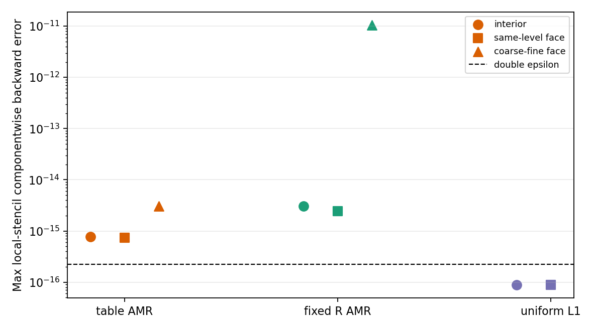

# WOR-92: failed FGMRES iterate by AMR row region

Date: 2026-11-07. The prior precision-floor experiments printed only the maximum **local-stencil** componentwise backward-error proxy. This trial-only diagnostic evaluates that same final FGMRES iterate separately in block interiors, cells touching same-level block faces, and cells touching at least one coarse-fine face. It changes no solver equation or acceptance gate. The three cases are the strict Tomida/Semenov table-R mixed AMR failure, its strict fixed-`κR=0.0652` passing control, and the uniform level-1 table-R failure. All use CFL 0.3, two MPI ranks, restart 40, two MG V-cycles, at most 300 iterations, and target `2e-8`. The FGMRES iteration counts and true residuals exactly match the corresponding earlier binaries in all three cases.

## Second linear solve

| Case | Interior cells / max η | Same-level face cells / max η | Coarse-fine face cells / max η | True relative residual | Result |
|---|---:|---:|---:|---:|---|
| Table-R mixed AMR | 25,920 / `7.665e-16` | 28,216 / `7.413e-16` | 7,304 / `3.086e-15` | `3.87966e-8` | fails |
| Fixed-R mixed AMR | 25,920 / `3.050e-15` | 28,216 / `2.420e-15` | 7,304 / `1.053e-11` | `1.98557e-8` | passes |
| Table-R uniform level 1 | 175,616 / `8.889e-17` | 86,528 / `8.836e-17` | none | `9.11880e-8` | fails |

The failed mixed-AMR table solve's maximum local proxy is at a coarse-fine face. Away from those faces, its maximum is about `3–4` times double epsilon (`2.22045e-16`). The fixed-R solve passes the normwise gate despite a much larger coarse-fine *maximum* local proxy (`1.053e-11`); this is an outlier row measure, not the residual norm. Its coarse-fine regional residual L2 is `1.584e-8`, versus `1.624e-8` for the failed table case. Therefore neither a single local maximum nor its coarse-fine location explains strict FGMRES success or failure.

On the uniform grid, every ghost is a same-level direct copy, so the local seven-point denominator corresponds to an assembled global row. The failed uniform iterate's `8.889e-17` is a valid global componentwise backward error below one epsilon. In mixed AMR, coarse-fine ghosts contain interpolation and face-weighted restriction; their local denominators do **not** expand those mappings into global unknowns. The mixed-AMR coarse-fine η values must not be used as exact global componentwise backward errors or as a production acceptance criterion. The interior and same-level rows are useful direct controls, but an all-row assembled audit remains open.



## Reproduction

The [regional CSV](wor92_backward_regions_results_20261107/regions.csv), [run CSV](wor92_backward_regions_results_20261107/runs.csv), [summary JSON](wor92_backward_regions_results_20261107/summary.json), [figure](wor92_backward_regions_results_20261107/backward_regions.png), [diagnostic-only source diff](wor92_backward_regions_results_20261107/diagnostic.patch), and [exact inputs/logs](wor92_backward_regions_results_20261107/evidence.tar.gz) capture the check. Diagnostic binary SHA-256 is `59a6ca9c2246b9936d8a7c7f34c20c5c6f3b53c349520f9f2411520fae20b66f`; baseline trial binary SHA-256 is `5b259bf3c0a4b768a6a35aa9f2d9cebfd3b9151f78b80ed5583069a772ffb691`. Base Git source is `ebf7634a8e877edfd58724de1e3810638a76ca7e` plus previously documented isolated WOR-92 trials. Regenerate data and figure with `python3 tst/nrfld_validation/wor92_backward_regions_20261107.py` in this report worktree.

Representative command from the bundle directory:

```bash
cd /home/kosuke/simulation/test/rad_nr/wor92_20261107/bundle
env ATHENA_NRFLD_CONSERVATIVE_PROTOTYPE=1 \
  ATHENA_NRFLD_CONSERVATIVE_SHARED_COEFF=1 \
  ATHENA_NRFLD_EXPERIMENTAL_TANGENTIAL_RECONSTRUCTION=1 \
  ATHENA_NRFLD_EXPERIMENTAL_VARIABLE_LIMITER=1 \
  ATHENA_NRFLD_EXPERIMENTAL_COUPLED=1 \
  ATHENA_NRFLD_EXPERIMENTAL_REGRID=1 \
  ATHENA_NRFLD_CONSERVATIVE_DIFFERENCE_JV=0 \
  ATHENA_WOR92_BACKWARD_REGIONS=1 \
  timeout 120s mpirun -np 2 \
  /home/kosuke/simulation/test/rad_nr/wor92_operator_audit_20261107/build_table_backward_regions/bin/athena \
  -i /home/kosuke/simulation/test/rad_nr/wor92_wor105_retest_20261107/input_table_component_freeze_cfl030_strict_3cycles.used \
  -d /path/to/fresh/output
```

For fixed R, add `ATHENA_WOR92_FIXED_ROSSELAND=1` and use the archived fixed-high input. For uniform level 1, use the archived uniform input. Each run requires a fresh output directory.

Next, expand the coarse-fine ghost transfer into active-cell coefficients for selected high-error rows, then evaluate assembled global componentwise error for the actual failed iterate. A production stopping-rule change requires that audit and Newton/physics regression. WOR-92 remains **In Progress**.
