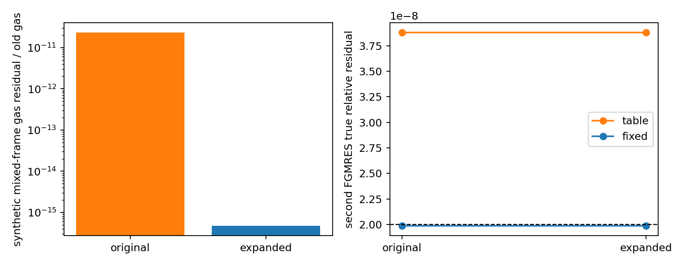

# WOR-92: mixed-frame local-root upper-bracket stress trial

The general-EOS mixed-frame local gas solve uses the greater of the old
gas energy and the LTE gas energy as its initial upper bracket. A synthetic
mixed-frame heating correction can place the root above both values.
In that case the trial solver falls back to a linearized gas update even
though a positive table-EOS root exists. This is an **edge-case local
robustness issue**, separate from the strict Semenov FGMRES stop.

I copied the existing trial build to an isolated build directory and
added a bounded upper-bracket expansion only when `mixed_active` and the
upper residual is negative. The change is in the archived
[trial patch](wor92_local_bracket_trial_results_20261107/bracket.patch).
No production source change was committed.

| Check | Original trial | Expanded bracket trial |
| --- | ---: | ---: |
| Synthetic strong mixed drift, relative gas-root error vs independent Python table root | `2.3182e-11` | `4.7012e-16` |
| Same case, independent gas residual / old gas | `2.3182e-11` | `4.6829e-16` |
| Eleven ordinary Tomida mixed-frame cell cases | same numeric lines | same numeric lines |
| Semenov table R, strict CFL 0.3, second FGMRES | `300`, `3.8796577724e-8`, fails | identical |
| Fixed κR=`0.0652`, strict CFL 0.3 | 3 cycles; 7/7 FGMRES pass | identical |

The stress harness sets a deliberately extreme synthetic mixed-drift
increment of `-1e8 ΔEr`, with `rho=5`, old gas energy
`967.2962193627`, old temperature about 1176 K, and
`dt c sigma_P=100`. The original log reports 511 exact-solve cells in
the sampled block, whereas the expanded-bracket log reports 512. The
changed cell's root is `971.6300005393591`, within `4.70e-16` of an
independent Python bisection result relative to old gas. This stress
condition is not a measured collapse state and does not establish that
the bracket is responsible for WOR-92's FGMRES failure.



The exploratory bracket binary is SHA-256
`3fcc8a83f756328b45a005b82d93afd5f6c0e268c3fe6928e96a33534609a3ee`;
the original trial binary is
`5b259bf3c0a4b768a6a35aa9f2d9cebfd3b9151f78b80ed5583069a772ffb691`.
The [summary JSON](wor92_local_bracket_trial_results_20261107/summary.json),
[stress CSV](wor92_local_bracket_trial_results_20261107/stress.csv),
[collapse CSV](wor92_local_bracket_trial_results_20261107/runs.csv), and
[inputs, logs, harness and build log](wor92_local_bracket_trial_results_20261107/evidence.tar.gz)
capture the exact runs. Generate the data and figure with:

```bash
cd /home/kosuke/simulation/athena_wor92_wor105_retest
python3 tst/nrfld_validation/wor92_local_bracket_trial_20261107.py
```

To reproduce the source trial, copy the isolated baseline build, apply
the archived patch from the copy's root with `patch -p1`, and run
`make -j4`. Run the Semenov input from
`/home/kosuke/simulation/test/rad_nr/wor92_20261107/bundle` with the
same seven `ATHENA_NRFLD_*` settings in the
[general-EOS report](wor92_local_general_eos_20261107.md), `timeout 180s
mpirun -np 2`, and a fresh `-d` output path. For the fixed-R control add
`ATHENA_WOR92_FIXED_ROSSELAND=1`; the table-R case must **omit** this
variable entirely. A discarded pilot set it to `0`, which still selected
fixed R because this trial checks its presence rather than its value.

I also created an isolated clean-source branch
`codex/wor92-general-eos-local-root-20261107` to test independent
integration. The local-root patch compiled, but the committed
`protostellar_core_fld` problem generator requires `hydro/gamma` and
initializes the ideal-gas setup; the Tomida input stopped before the
cell probe. The table-EOS problem-generator support remains a separate
uncommitted trial dependency. The clean branch is left uncommitted and
unpublished. This prevents representing the bracket patch as a verified
standalone production change.

Next, validate a physically reached late-collapse mixed-frame state,
integrate the table-EOS problem generator and local-root patch in a
clean source branch, and rerun the strict Semenov CFL-0.3 linear and
Newton tests. WOR-92 remains **In Progress**. XD2000 was not accessed.
