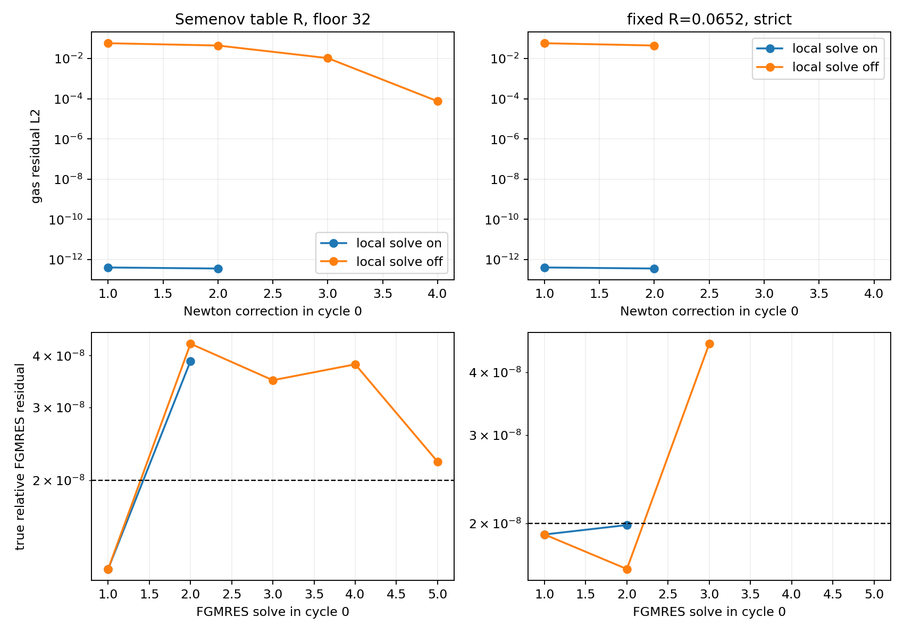

# WOR-92: general-EOS exact local gas solve in collapse

## Question and implementation state

The local gas solve that improved ideal-gas WOR-93 is applicable to the
Tomida table EOS in the **trial** NR-FLD source. `NRFLD::AddDifference`
bisects the monotone table-EOS matter equation after applying the radiation
correction. The trial removes the former `!mixed_active` guard and includes
the frozen-coefficient mixed-frame drift change in that scalar equation.
The `cut_diff` coupled special case still uses the total-energy constraint;
the present collapse runs use full diffusion and the bracketed gas root.
This source remains uncommitted and is not yet a production fix.

All controls below use the same trial binary, SHA-256
`5b259bf3c0a4b768a6a35aa9f2d9cebfd3b9151f78b80ed5583069a772ffb691`,
on the WOR-105-based report branch at starting Git commit
`357f16d321b4534dafda53ce1b42d7ad02a19f5c`. They use Tomida EOS,
Semenov Planck opacity, CFL 0.3, 32³ root, small AMR, two MPI ranks,
flux-form matvec, restart 40, two MG V-cycles, and the same mixed-frame
configuration. The first actual timestep is `31.114819909` code units.
The controls change only `nrfld/exact_local_gas_solve` within each pair.

## Controlled results

| Rosseland choice and FGMRES gate | Local solve on | Local solve off |
| --- | --- | --- |
| Semenov table, `2e-8` target with factor-32 precision-floor acceptance | 10 cycles; 22 linear solves, 4 floor accepts; Newton converged each cycle | Cycle 0 stops in solve 5 at true residual `2.21534e-8`; three earlier floor accepts |
| Fixed κR=`0.0652`, strict `2e-8` true residual | 3 cycles; 7/7 linear solves strictly pass | Cycle 0 stops in solve 3 at true residual `4.55637e-8` |

For the first Newton correction with Semenov table Rosseland opacity, the
global gas residual L2 is `4.05e-13` with the local root and `5.840e-2`
with the linearized gas correction. The logged root-block maximum local
matter residual divided by gas energy scale is `3.47e-13`; the block
reports 512 exact-solve cells and `mixed_active=1`. With fixed Rosseland,
the corresponding first gas residual L2 values are `4.06e-13` and
`5.842e-2`. These results directly support a large Newton improvement
for **general EOS with mixed frame** in the tested early-collapse state.



An independent one-cycle energy-ledger run with the local solve enabled
converged in two Newton corrections. Its per-rank relative implicit
energy-balance values were `2.98e-9` and `3.23e-9`; the corresponding
absolute relative balances were `2.18e-7` and `2.16e-7`. This is a
consistency check at the configured Newton tolerance, not a proof of
long-duration conservation or mixed-frame physical accuracy.

The earlier **strict** Semenov table run still fails the second cycle-0
FGMRES solve at `3.87966e-8` with the local solve on, versus `4.27213e-8`
with it off. The precision-floor ten-cycle success therefore does not
satisfy WOR-92's strict CFL-0.3 completion condition. The fixed-R control
isolates conditioning, but changing the physical Rosseland opacity is not
proposed as a solver fix. The Semenov/Optab definition question remains
separate.

## Evidence and reproduction

The [summary JSON](wor92_local_general_eos_results_20261107/summary.json),
[run CSV](wor92_local_general_eos_results_20261107/runs.csv),
[Newton CSV](wor92_local_general_eos_results_20261107/cycle0_trials.csv),
[FGMRES CSV](wor92_local_general_eos_results_20261107/linear.csv),
[ledger CSV](wor92_local_general_eos_results_20261107/ledger.csv), and
[evidence archive](wor92_local_general_eos_results_20261107/evidence.tar.gz)
contain exact inputs, full logs, and the binary's isolated source snapshot,
Makefile, and configuration. The archive's source snapshot is evidence of
the trial binary; it does not mark those source changes as verified.
Regenerate the CSV/JSON and figure with:

```bash
cd /home/kosuke/simulation/athena_wor92_wor105_retest
python3 tst/nrfld_validation/wor92_local_general_eos_20261107.py
```

To rerun any archived input from the table-data bundle directory, use a
fresh output path and the archived binary source/build configuration:

```bash
cd /home/kosuke/simulation/test/rad_nr/wor92_20261107/bundle
env ATHENA_NRFLD_CONSERVATIVE_PROTOTYPE=1 \
  ATHENA_NRFLD_CONSERVATIVE_SHARED_COEFF=1 \
  ATHENA_NRFLD_EXPERIMENTAL_TANGENTIAL_RECONSTRUCTION=1 \
  ATHENA_NRFLD_EXPERIMENTAL_VARIABLE_LIMITER=1 \
  ATHENA_NRFLD_EXPERIMENTAL_COUPLED=1 \
  ATHENA_NRFLD_EXPERIMENTAL_REGRID=1 \
  ATHENA_NRFLD_CONSERVATIVE_DIFFERENCE_JV=0 \
  timeout 180s mpirun -np 2 /path/to/isolated/bin/athena \
  -i /path/to/extracted/inputs/table_off_floor32.used \
  -d /path/to/fresh/output
```

For either fixed-R input, also set `ATHENA_WOR92_FIXED_ROSSELAND=1`.
For the ledger input, also set `ATHENA_NRFLD_ENERGY_LEDGER=1`. Without
the fixed-R environment variable, the input's `radiation/kappa_R` value
is ignored because the Semenov lookup is enabled; a discarded pilot with
that missing variable was excluded from the comparison.

## Remaining checks

1. Probe table states later in collapse, across temperature knots and
   pressure floors, with the mixed-frame local root; the present 10-cycle
   test is only an early-collapse pilot.
2. Compute a true assembled AMR-aware componentwise backward error for
   the stalled linear solve, including ghost interpolation. The current
   local-stencil proxy omits that operation.
3. Improve the preconditioned linear solve under low Rosseland opacity,
   then rerun the strict Semenov CFL-0.3 case, regrid/restart, and a longer
   collapse interval. The local gas root is useful but insufficient alone.

WOR-92 remains **In Progress**. No solver source change is committed here.
XD2000 was not accessed.
