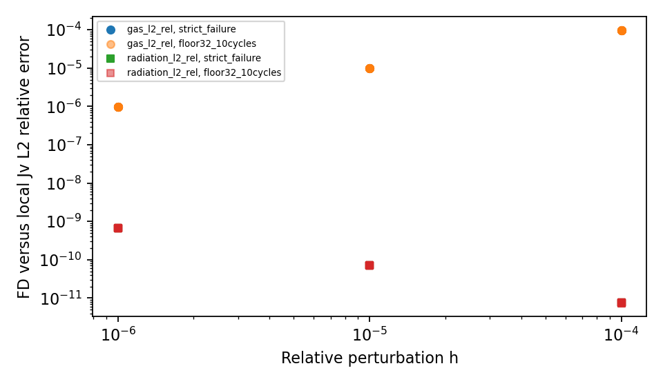

# WOR-92: local gas/radiation Jacobian probe

The existing `NRFLD::RunJacobianDiagnostic` finite-difference routine
was present in source but had no caller. In a **copied, isolated build
tree only**, a one-line diagnostic hook called it after coefficient
construction. The source change is archived as a patch and is not a
production change. The trial binary is SHA-256
`deda2405d897faf69cfe65d34ac46a5907487083aa03da42829e4e047ca9a82d`;
the patch is SHA-256
`975391cd4148f859a048bcf7780c231026dba544309ea1362ea82a188d3f0317`.
Both runs use the WOR-105-based branch at base Git commit
`ebf7634a8e877edfd58724de1e3810638a76ca7e` with Tomida EOS,
Semenov opacity, CFL 0.3, 32³ root, small AMR, two ranks, restart 40
and two MG V-cycles.

The first run kept the strict `2e-8` FGMRES target and failed in cycle 0
at the **same** second-solve residual `3.8796577724e-8` as the run
without diagnostics. The second run used the previously documented
factor-32 precision-floor acceptance for ten cycles. It completed ten
Newton solves and 22 FGMRES solves. Its 22 FGMRES output lines are
byte-identical to the corresponding no-diagnostic run, SHA-256
`7831f4a0247e7075a6d3787b8463be2375b11d81c9fb4b0eae2dad8dbf623b3f`.

The routine probes 343 cells inside MeshBlock `gid=0` and excludes one
cell next to each internal MeshBlock face. It ran at three relative
perturbation sizes for every cycle 0–9 in the ten-cycle control:

| Perturbation h | Maximum gas L2 relative discrepancy across cycles | Maximum radiation L2 relative discrepancy |
| ---: | ---: | ---: |
| 1e-4 | 9.76531e-5 | 7.51190e-12 |
| 1e-5 | 9.76668e-6 | 7.08653e-11 |
| 1e-6 | 9.80342e-7 | 6.79985e-10 |

The gas discrepancy decreases approximately in proportion to h, as
expected for a forward finite difference. The radiation L2 discrepancy
is smallest at the largest h and grows as h shrinks, consistent with
roundoff in this strongly diffusion-dominated calculation. The largest
pointwise radiation discrepancy at h=1e-6 is `1.37e-6`; the aggregate
L2 metric is much smaller. This probe supports the **local interior**
gas-radiation and radiation Jacobian terms in the sampled block. It
does not test the assembled global AMR boundary action, ghost
interpolation derivative, or all MeshBlocks, so it cannot clear the
remaining Jacobian-consistency question for WOR-92.



The [summary JSON](wor92_local_jacobian_results_20261107/summary.json),
[Jacobian CSV](wor92_local_jacobian_results_20261107/jacobian.csv),
[run CSV](wor92_local_jacobian_results_20261107/runs.csv), and
[logs, exact inputs, original comparator log and diagnostic patch](wor92_local_jacobian_results_20261107/evidence.tar.gz)
record all evidence. Regenerate the data and figure with:

```bash
cd /home/kosuke/simulation/athena_wor92_wor105_retest
python3 tst/nrfld_validation/wor92_local_jacobian_20261107.py
```

Rerun the strict case from the bundle directory with the same
conservative trial environment documented in the
[Rosseland report](wor92_rosseland_threshold_20261107.md):

```bash
cd /home/kosuke/simulation/test/rad_nr/wor92_20261107/bundle
env ATHENA_NRFLD_CONSERVATIVE_PROTOTYPE=1 \
  ATHENA_NRFLD_CONSERVATIVE_SHARED_COEFF=1 \
  ATHENA_NRFLD_EXPERIMENTAL_TANGENTIAL_RECONSTRUCTION=1 \
  ATHENA_NRFLD_EXPERIMENTAL_VARIABLE_LIMITER=1 \
  ATHENA_NRFLD_EXPERIMENTAL_COUPLED=1 \
  ATHENA_NRFLD_EXPERIMENTAL_REGRID=1 \
  ATHENA_NRFLD_CONSERVATIVE_DIFFERENCE_JV=0 \
  timeout 120s mpirun -np 2 /path/to/isolated/diagnostic/bin/athena \
  -i /path/to/input_table_local_jacobian_cfl030_strict_3cycles.used \
  -d /path/to/fresh/output
```

An AMR-aware finite-difference Jacobian check and assembled
componentwise backward error remain the next technical steps. No
solver source change is verified for commit. WOR-92 remains **In
Progress**. XD2000 was not accessed.
