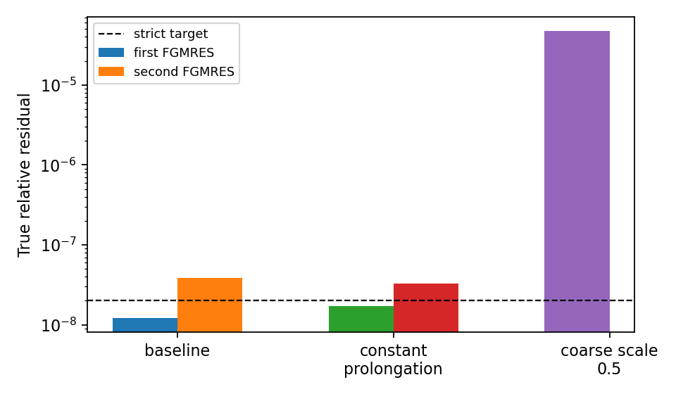

# WOR-92: bounded AMR multigrid parameter controls

On the same isolated WOR-105-based branch and Tomida/Semenov 32³-root,
small-AMR, two-rank CFL-0.3 reproducer used in the
[Rosseland analysis](wor92_rosseland_threshold_20261107.md), I changed
one supported multigrid parameter at a time. FGMRES retained restart
40, two MG V-cycles, 300 maximum iterations, and a strict `2e-8` true
residual target. The baseline trial binary is SHA-256
`5b259bf3c0a4b768a6a35aa9f2d9cebfd3b9151f78b80ed5583069a772ffb691`;
base Git commit is `ebf7634a8e877edfd58724de1e3810638a76ca7e`.

| Parameter change | First FGMRES | Second FGMRES | First reported finest-level MG correction/full residual-norm factor | Outcome |
| --- | ---: | ---: | ---: | --- |
| baseline: trilinear, coarse scale 1, 2+2 sweeps | 156 iterations, 1.219e-8 | 300, 3.880e-8 | 33.1 / 2.28 | fails cycle 0 |
| constant prolongation | 164, 1.722e-8 | 300, 3.299e-8 | 8.89 / 2.89 | fails cycle 0 |
| coarse correction scale 0.5 | 300, 4.709e-5 | not reached | 1.207e4 / 7.006e3 | fails first solve |
| 4 pre + 4 post sweeps | no completed FGMRES | not reached | 105.6 / 4.00 | 300 s timeout |

The MG transfer diagnostic is a norm ratio within its first reported
V-cycle, not the FGMRES true residual. It shows large coarse-correction
amplification in the baseline; the final fine-level norm in that V-cycle
is 2.28 times its starting norm. Constant prolongation reduces the
instantaneous correction ratio but does not meet the strict linear gate.
Halving the correction scale makes both the V-cycle factor and FGMRES
result much worse. Extra smoothing did not complete one FGMRES solve
within the bounded 300-second run, so the planned 8+8-sweep control was
skipped. These tests do not identify a production parameter fix.

The existing `coarse_operator=galerkin` path explicitly rejects
AMR/SMR topology in `linearMGDriver`; it cannot serve as a settings-only
control for this mixed-level case. Implementing an AMR-aware coarse
operator would require separate source work and validation.



Reproduce the [JSON](wor92_mg_controls_results_20261107/summary.json),
[CSV](wor92_mg_controls_results_20261107/runs.csv) and figure with:

```bash
cd /home/kosuke/simulation/athena_wor92_wor105_retest
python3 tst/nrfld_validation/wor92_mg_controls_20261107.py
```

The [evidence archive](wor92_mg_controls_results_20261107/evidence.tar.gz)
contains all exact inputs, stdout/stderr logs and exit statuses. Run each
input from `/home/kosuke/simulation/test/rad_nr/wor92_20261107/bundle`
with the conservative WOR-105 trial environment listed in the
[Rosseland report](wor92_rosseland_threshold_20261107.md), for example:

```bash
env ATHENA_NRFLD_CONSERVATIVE_PROTOTYPE=1 \
  ATHENA_NRFLD_CONSERVATIVE_SHARED_COEFF=1 \
  ATHENA_NRFLD_EXPERIMENTAL_TANGENTIAL_RECONSTRUCTION=1 \
  ATHENA_NRFLD_EXPERIMENTAL_VARIABLE_LIMITER=1 \
  ATHENA_NRFLD_EXPERIMENTAL_COUPLED=1 \
  ATHENA_NRFLD_EXPERIMENTAL_REGRID=1 \
  ATHENA_NRFLD_CONSERVATIVE_DIFFERENCE_JV=0 \
  timeout 120s mpirun -np 2 /path/to/isolated/table/bin/athena \
  -i /path/to/input_table_constant_prolongation_cfl030_strict_3cycles.used \
  -d /path/to/fresh/output
```

The next useful work is a measured AMR-aware Jacobian and preconditioner
consistency check in the low-κR state, including a true componentwise
backward error. No solver source trial from this matrix is verified for
commit. WOR-92 remains **In Progress**; no XD2000 access occurred.
