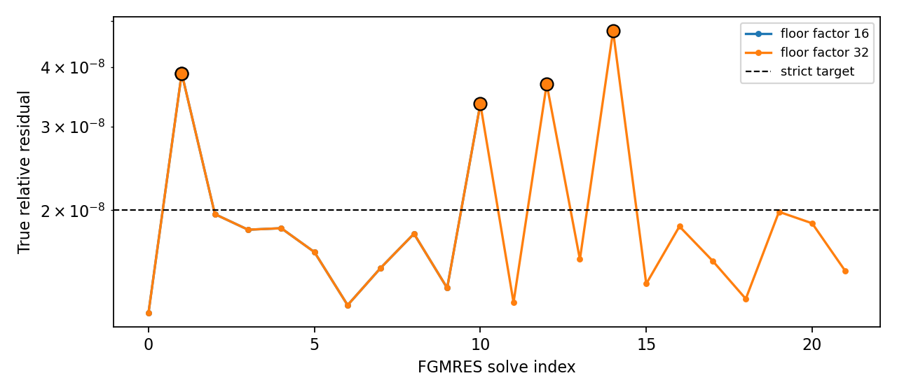

# WOR-92: ten-cycle sensitivity to FGMRES precision-floor acceptance

Two bounded local runs extended the Tomida/Semenov, 32³-root,
mixed-AMR, two-rank, CFL-0.3 reproducer to ten requested cycles. They
used the same isolated WOR-105-based trial binary, SHA-256
`5b259bf3c0a4b768a6a35aa9f2d9cebfd3b9151f78b80ed5583069a772ffb691`,
and identical settings apart from
`nrfld/fgmres_precision_floor_factor=16` versus `32`. The true relative
residual target stayed `2e-8`, restart 40, two MG V-cycles and 300
maximum iterations. The base Git commit is
`ebf7634a8e877edfd58724de1e3810638a76ca7e`.

| Floor factor | Last cycle | FGMRES solves | Newton converged | Floor-accepted solves | Largest true residual | Result |
| ---: | ---: | ---: | ---: | ---: | ---: | --- |
| 16 | 4 | 11 | 4 | 1 | 3.87966e-8 | fails cycle 4 second linear solve |
| 32 | 10 | 22 | 10 | 4 | 4.76139e-8 | ten cycles complete |

At cycle 4, factor 16 rejects a `3.34453e-8` true residual with
local-stencil backward-error proxy `3.78052e-15`, just above
`16 × ε = 3.55271e-15` for double precision. Factor 32 accepts that
solve and three other solves whose true residuals exceed the strict
target; its largest is `4.76139e-8`, or 2.38 times the target. Its
accepted proxy values are `3.09e-15`, `3.78e-15`, `5.33e-15`, and
`3.95e-15`. The final reported time is 290.75 code units; this is far
short of the intended protostellar collapse endpoint. Actual first dt
is 31.1148 code units, with the last reported dt 28.5359.

The factor-32 result demonstrates **acceptance-policy sensitivity**, not
strict FGMRES convergence or a verified numerical fix. In particular,
the current proxy treats interpolated AMR ghost values as independent
stencil neighbors, so it is not an assembled AMR-matrix componentwise
backward error. A reliable acceptance rule needs that missing check,
plus independent conservation and longer-collapse validation. The
Semenov-versus-Optab opacity definition remains a separate physics
question.



The [summary JSON](wor92_precision_floor_results_20261107/summary.json),
[run CSV](wor92_precision_floor_results_20261107/runs.csv),
[per-solve CSV](wor92_precision_floor_results_20261107/solves.csv), and
[logs and exact inputs](wor92_precision_floor_results_20261107/evidence.tar.gz)
contain the full evidence and hashes. Regenerate summaries and figure:

```bash
cd /home/kosuke/simulation/athena_wor92_wor105_retest
python3 tst/nrfld_validation/wor92_precision_floor_20261107.py
```

The ten-cycle inputs in the archive can be rerun from
`/home/kosuke/simulation/test/rad_nr/wor92_20261107/bundle`:

```bash
env ATHENA_NRFLD_CONSERVATIVE_PROTOTYPE=1 \
  ATHENA_NRFLD_CONSERVATIVE_SHARED_COEFF=1 \
  ATHENA_NRFLD_EXPERIMENTAL_TANGENTIAL_RECONSTRUCTION=1 \
  ATHENA_NRFLD_EXPERIMENTAL_VARIABLE_LIMITER=1 \
  ATHENA_NRFLD_EXPERIMENTAL_COUPLED=1 \
  ATHENA_NRFLD_EXPERIMENTAL_REGRID=1 \
  ATHENA_NRFLD_CONSERVATIVE_DIFFERENCE_JV=0 \
  timeout 180s mpirun -np 2 /path/to/isolated/table/bin/athena \
  -i /path/to/input_mixed_amr_cfl030_restart40_mg2_floor32_10cycles.used \
  -d /path/to/fresh/output
```

No solver source fix is verified by these runs. WOR-92 remains **In
Progress**. No XD2000 login or job submission occurred.
