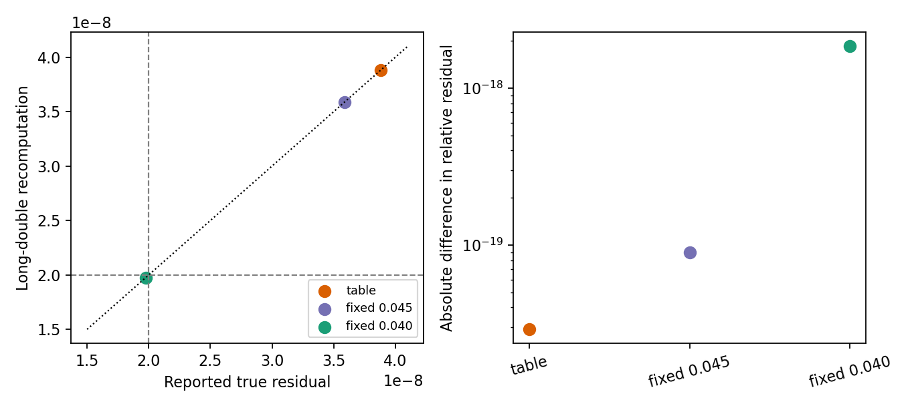

# WOR-92: independent long-double recomputation of the FGMRES residual

Date: 2026-11-07. This follows the [restart-floor study](wor92_restart_floor_20261107.md) on the isolated WOR-105-based Tomida/Semenov 32³-root, small-AMR, two-rank CFL-0.3 reproducer. The production FGMRES matvec accumulates the flux-form row in `long double`, casts its result to `Real` (double), then subtracts from the right-hand side in double. To test whether this cast or subtraction explains the `~4e-8` residual plateau, a diagnostic-only copied build independently recomputed each final row and `b−Ax` in `long double`, using the same synchronized correction ghosts and coefficients. The strict acceptance gate was unchanged.

## Results at the second linear solve

| Case | Reported true relative residual | Independent long-double residual | Difference | `Ax` cast difference / `||b||` | Outcome |
|---|---:|---:|---:|---:|---|
| Table Rosseland | `3.8796577724025381e-8` | `3.8796577723996367e-8` | `2.90e-20` | `5.25e-17` | fails 300 iterations |
| Fixed Rosseland `0.0450` | `3.5887924227470704e-8` | `3.5887924227381195e-8` | `8.95e-20` | `5.51e-17` | fails 300 iterations |
| Fixed Rosseland `0.0400` | `1.9759005736414776e-8` | `1.9759005738259193e-8` | `1.84e-18` | `5.18e-17` | passes at 151 iterations |

The independent residual is effectively identical to the reported value on both failed and passing cases. Casting the matvec result back to double and subtracting `b−Ax` in double do **not** explain the strict residual failure. The diagnostic-on/off runs using the same binary reproduce the original table FGMRES iteration counts and residuals exactly. The local-stencil componentwise backward-error proxy remains around `3.09e-15` (table) and `4.11e-15` (fixed `0.0450`) on the failed solve; it still does not account for AMR ghost interpolation as assembled global rows.



## Reproduction

The diagnostic binary is `/home/kosuke/simulation/test/rad_nr/wor92_operator_audit_20261107/build_table_residual_precision/bin/athena` (SHA-256 `6740cc1519aa769bf76a744acd2419ed76f6e2bc137987c827f983ecee3fab1b`). Baseline trial binary SHA-256 is `5b259bf3c0a4b768a6a35aa9f2d9cebfd3b9151f78b80ed5583069a772ffb691`; base Git source is `ebf7634a8e877edfd58724de1e3810638a76ca7e` plus the isolated, uncommitted WOR-92 trials already documented. The [CSV](wor92_residual_precision_results_20261107/residuals.csv), [run CSV](wor92_residual_precision_results_20261107/runs.csv), [JSON](wor92_residual_precision_results_20261107/summary.json), [source diff](wor92_residual_precision_results_20261107/diagnostic.patch), and [exact logs/inputs](wor92_residual_precision_results_20261107/evidence.tar.gz) record the check.

Representative command from the bundle directory:

```bash
cd /home/kosuke/simulation/test/rad_nr/wor92_20261107/bundle
env ATHENA_NRFLD_CONSERVATIVE_PROTOTYPE=1 \
  ATHENA_NRFLD_CONSERVATIVE_SHARED_COEFF=1 \
  ATHENA_NRFLD_EXPERIMENTAL_TANGENTIAL_RECONSTRUCTION=1 \
  ATHENA_NRFLD_EXPERIMENTAL_VARIABLE_LIMITER=1 \
  ATHENA_NRFLD_EXPERIMENTAL_COUPLED=1 \
  ATHENA_NRFLD_EXPERIMENTAL_REGRID=1 \
  ATHENA_NRFLD_CONSERVATIVE_DIFFERENCE_JV=0 \
  ATHENA_WOR92_LONG_DOUBLE_RESIDUAL=1 \
  timeout 120s mpirun -np 2 \
  /home/kosuke/simulation/test/rad_nr/wor92_operator_audit_20261107/build_table_residual_precision/bin/athena \
  -i /home/kosuke/simulation/test/rad_nr/wor92_wor105_retest_20261107/input_table_component_freeze_cfl030_strict_3cycles.used \
  -d /path/to/fresh/output
```

For fixed Rosseland controls, set `ATHENA_WOR92_FIXED_ROSSELAND=1` and use the archived `0.0400` or `0.0450` input. Omit `ATHENA_WOR92_LONG_DOUBLE_RESIDUAL` for the same-binary control. Run `python3 tst/nrfld_validation/wor92_residual_precision_20261107.py` in the report worktree to regenerate data and figure.

The next material check is an assembled AMR componentwise backward error for the **actual** failed FGMRES iterate and row-level separation of diffusion and gas-coupling terms. A high-precision solver or alternative preconditioner would require a separate bounded trial and strict Newton/physics regression. No production source fix is validated; WOR-92 remains **In Progress**.
