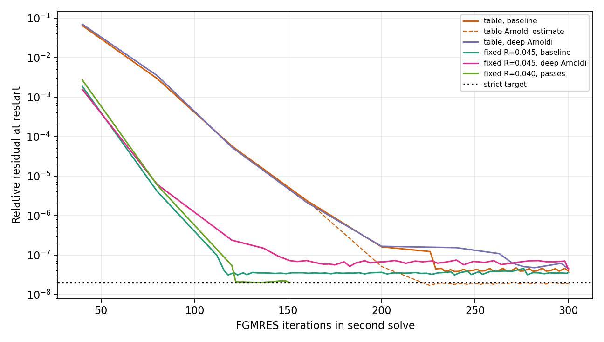

# WOR-92: nonmonotone fixed-R controls and FGMRES restart floor

Date: 2026-11-07. Isolated WOR-105-based table-EOS/Semenov trial on 32³ root, small AMR, two MPI ranks, CFL 0.3. The linear gate remains a strict `2e-8` **recomputed true relative residual**, restart width 40, two MG V-cycles, and at most 300 FGMRES iterations. Base Git source is `ebf7634a8e877edfd58724de1e3810638a76ca7e` plus the uncommitted, isolated WOR-92 numerical probes described in preceding reports. All new source in this experiment is diagnostic/trial-only in a separate copied build tree.

## Fixed Rosseland coefficients

The [earlier Rosseland report](wor92_rosseland_threshold_20261107.md) found fixed `κR=0.0321456353` failed, whereas `0.05` and `0.0652` passed a three-cycle strict check. Three intermediate constant values give a **nonmonotone** response:

| Fixed κR (cm²/g) | Second FGMRES | Three-cycle result |
|---:|---:|---|
| `0.0400` | 151 iterations, `1.97590e-8` | passes; 7/7 solves strict |
| `0.0450` | 300, `3.58879e-8` | fails cycle 0 |
| `0.0475` | 113, `1.42168e-8` | passes; 7/7 solves strict |

The `0.0450` case was rerun once from a fresh output directory. Both runs produced the same FGMRES iteration counts and true residuals. All inputs differ from the earlier fixed-`0.0652` input only in `radiation/kappa_R`. Table Planck opacity remains active. This eliminates a simple monotone “low opacity threshold” explanation: `0.0400` passes while `0.0450` fails. A strict pass at these short bounds does not establish long collapse stability or justify replacing the physical opacity.

## Restart diagnostic and trial

I added a trial-only restart log that prints the Arnoldi residual estimate and the recomputed true residual after each FGMRES restart. The diagnostic-only binary reproduces the original table run exactly: first solve 156 iterations/`1.21891e-8`; second solve 300/`3.87966e-8`.

In the table run's second solve, 32 of 37 restart endpoints had Arnoldi estimate below `2e-8` but true residual above it. Thirty-one restarts used only 2–3 inner iterations. At iteration 300 the estimate was `1.84358e-8`, while the true residual was `3.87966e-8`. For fixed `κR=0.0450`, 62 of 65 endpoints had this estimate/true split. The passing `0.0400` case also had the split at intermediate restarts; its true residual eventually reached `1.97590e-8` at iteration 151. Thus the estimate gap accompanies stagnation but is not alone a failure criterion.

To test whether premature inner termination causes the failure, a separate trial required the Arnoldi estimate to fall below **one tenth** of the unchanged true-residual target before ending the inner cycle. The table run's second solve still failed at 300 iterations, now with true residual `4.47361e-8`; fixed `0.0450` failed at 300/`4.28509e-8`. The table trial's last Arnoldi estimate was `2.35156e-9` versus true residual `4.47361e-8`. The deeper Arnoldi trial is therefore **rejected**; no production source change is committed. With the deep-trial binary but its feature flag disabled, the table FGMRES counts and true residuals exactly match the diagnostic-only run.

The local-stencil backward-error proxy on the failed second solve is `3.09e-15` for table-R and `4.11e-15` for fixed `0.0450`, whereas the strict true relative residual remains above target. This proxy is not an assembled global componentwise error because AMR ghosts are interpolated. The data are consistent with a strong residual floor from this ill-conditioned solve, but do not establish whether global rounding, preconditioner error, or an assembled-row discrepancy dominates. Increasing the maximum iteration count alone had already failed in the earlier control.



## Reproduction and evidence

The [run CSV](wor92_restart_floor_results_20261107/runs.csv), [restart CSV](wor92_restart_floor_results_20261107/restarts.csv), [summary JSON](wor92_restart_floor_results_20261107/summary.json), [plot](wor92_restart_floor_results_20261107/restart_residuals.png), [exact inputs and logs](wor92_restart_floor_results_20261107/evidence.tar.gz), [trace-only patch](wor92_restart_floor_results_20261107/trace_only.patch), and [trace plus trial patch](wor92_restart_floor_results_20261107/diagnostic_and_trial.patch) capture the experiment. Baseline binary SHA-256 is `5b259bf3c0a4b768a6a35aa9f2d9cebfd3b9151f78b80ed5583069a772ffb691`; trace-only binary `34682a1575a300904abab5af8e0fc3b4fa36c7e60afaa0addd153e522cdc6ac7`; deep-trial binary `b36157d50e185ca01154de281351267983c104d835ffa2f91da038e55d75ad1f`.

Representative diagnostic command from the bundle directory (all cases use fresh output directories):

```bash
cd /home/kosuke/simulation/test/rad_nr/wor92_20261107/bundle
env ATHENA_NRFLD_CONSERVATIVE_PROTOTYPE=1 \
  ATHENA_NRFLD_CONSERVATIVE_SHARED_COEFF=1 \
  ATHENA_NRFLD_EXPERIMENTAL_TANGENTIAL_RECONSTRUCTION=1 \
  ATHENA_NRFLD_EXPERIMENTAL_VARIABLE_LIMITER=1 \
  ATHENA_NRFLD_EXPERIMENTAL_COUPLED=1 \
  ATHENA_NRFLD_EXPERIMENTAL_REGRID=1 \
  ATHENA_NRFLD_CONSERVATIVE_DIFFERENCE_JV=0 \
  ATHENA_WOR92_FGMRES_RESTART_TRACE=1 \
  timeout 120s mpirun -np 2 \
  /home/kosuke/simulation/test/rad_nr/wor92_operator_audit_20261107/build_table_restart_trace/bin/athena_trace \
  -i /home/kosuke/simulation/test/rad_nr/wor92_wor105_retest_20261107/input_table_component_freeze_cfl030_strict_3cycles.used \
  -d /path/to/fresh/output
```

For a deep-Arnoldi trial, use `/home/kosuke/simulation/test/rad_nr/wor92_operator_audit_20261107/build_table_restart_trace/bin/athena` and set `ATHENA_WOR92_FGMRES_DEEP_ARNOLDI=1`; omit it for the same-binary control. For constant-R runs set `ATHENA_WOR92_FIXED_ROSSELAND=1` and use the archived fixed-R input. Regenerate tables and figure with `python3 tst/nrfld_validation/wor92_restart_floor_20261107.py` in the report worktree.

Next, measure the actual second-solve `b−Ax` with assembled AMR row contributions and global componentwise backward error. A precision-aware solver improvement would need a strict true-residual and Newton/physics regression on both fixed-R and table-R cases. WOR-92 remains **In Progress**.
