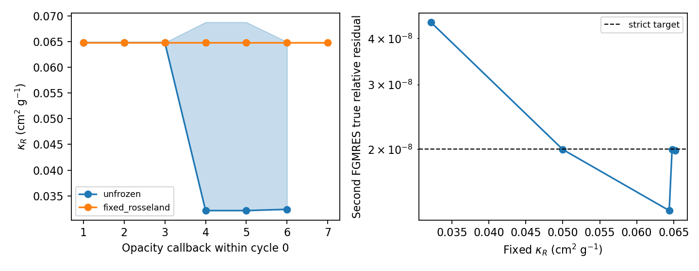

# WOR-92: cycle-0 Rosseland update and strict FGMRES threshold

This local follow-up uses the isolated WOR-105-based trial branch
`codex/wor92-wor105-retest-20261107`, based on
`ebf7634a8e877edfd58724de1e3810638a76ca7e`. The common setup is a
Tomida table EOS, Semenov opacity, 32³ root with 8³ blocks and small AMR,
two MPI ranks, CFL 0.3, restart 40, two MG V-cycles, 300 FGMRES iterations,
and a **strict** `2e-8` true-relative-residual threshold. The
precision-floor acceptance factor is zero. The controls are short
three-cycle numerical probes, not a validated collapse run.

## Results

The initial opacity callback is nearly uniform at 14 K:
κR=`0.06478477297739327`–`0.06478477297739482` cm²/g. On callback 4 of
**cycle 0**, after the state has evolved, the active-cell temperature is
`9.74504`–`14.43371` K and the table-derived κR is
`0.0321456`–`0.0687552` cm²/g. These ranges cover all 120 active leaf
blocks. The minimum is in a level-2 block; the level-3 blocks span
`0.0363021`–`0.0687552` cm²/g. Both table and fixed-R controls show the
same temperature range on this callback. Thus the previously measured
sub-0.6% κR spread at cycles 4–5 does **not** describe the first-cycle
FGMRES failure: cycle 0 reaches a roughly factor-two lower κR.

| Rosseland selection | First FGMRES (iterations, true residual) | Second FGMRES (iterations, true residual) | Three-cycle result |
| --- | ---: | ---: | --- |
| Semenov table | 156, 1.21891e-8 | 300, 3.87966e-8 | fails cycle 0 |
| fixed 0.0321456353 | 72, 1.54710e-8 | 300, 4.42671e-8 | fails cycle 0 |
| fixed 0.05 | 67, 1.68531e-8 | 123, 1.99696e-8 | passes 3 cycles, 7/7 strict linear |
| fixed 0.0644 | 61, 1.98340e-8 | 107, 1.36307e-8 | passes 3 cycles, 7/7 strict linear |
| fixed 0.064784773 | 61, 1.90976e-8 | 107, 1.99855e-8 | passes 3 cycles, 7/7 strict linear |
| fixed 0.0652 | 61, 1.90162e-8 | 109, 1.98557e-8 | passes 3 cycles, 7/7 strict linear |

All fixed-R controls continue to use the table-derived Planck component
and execute both opacity table lookups. The global fixed value matching
the **minimum** cycle-0 table κR also fails, while 0.05 and values near
the initial 14 K opacity pass this short test. This supports the low
Rosseland regime as a contributor to poor conditioning; spatial variation
is not required for a failure. It does not prove that the Semenov lookup
is wrong or that replacing its physical opacity is an acceptable fix.
The fixed-R `0.05` and initial-value passes reach residuals very close
to the target, so they are not robust production solutions.

Coefficient diagnostics for the first two linear solves show the
fine-meshblock diffusion diagonal maximum at `3.93213e10` with table-R,
versus `3.45238e10` with fixed initial R. The minimum reaction fraction
is only `2.62e-11` versus `2.98e-11`. No nonpositive diagonal or
positive/nonfinite off-diagonal was reported; matrix row error is below
`6e-16` relative to the diagonal. The coefficient and matrix fingerprints
differ from the first solve, as expected once the opacity changes. These
diagnostics establish a strongly diffusion-dominated matrix and a
distinct preconditioned problem, but do not identify a faulty matrix
entry. The local-stencil backward-error proxy remains limited by
interpolated AMR ghosts, so an assembled AMR-aware componentwise error
check is still needed.



## Reproduction and provenance

The [summary JSON](wor92_rosseland_threshold_results_20261107/summary.json),
[run CSV](wor92_rosseland_threshold_results_20261107/runs.csv),
[coefficient CSV](wor92_rosseland_threshold_results_20261107/coefficients.csv),
[per-block opacity CSV](wor92_rosseland_threshold_results_20261107/opacity_calls.csv),
[callback summary CSV](wor92_rosseland_threshold_results_20261107/opacity_call_summary.csv),
and [logs, inputs and diagnostic patch](wor92_rosseland_threshold_results_20261107/evidence.tar.gz)
contain the exact evidence. Regenerate summaries and figure with:

```bash
cd /home/kosuke/simulation/athena_wor92_wor105_retest
python3 tst/nrfld_validation/wor92_rosseland_threshold_20261107.py
```

The component-freeze trial binary is SHA-256
`5b259bf3c0a4b768a6a35aa9f2d9cebfd3b9151f78b80ed5583069a772ffb691`.
The separate cycle-0 callback diagnostic binary is SHA-256
`9c56a137c37470b5e395a62f9480bda620bd47a1d682976927c407b491827216`.
Its diagnostic-only patch is SHA-256
`9d75a7da65045d24de098d799eb4a1073a717ee2e6ef0522c486c2dac5489bc6`.
The summary JSON records input and log hashes. All source trials remain
uncommitted in isolated worktrees or copied build trees.

For example, reproduce the strict table-R failure from the bundle
directory using the archived input:

```bash
cd /home/kosuke/simulation/test/rad_nr/wor92_20261107/bundle
env ATHENA_NRFLD_CONSERVATIVE_PROTOTYPE=1 \
  ATHENA_NRFLD_CONSERVATIVE_SHARED_COEFF=1 \
  ATHENA_NRFLD_EXPERIMENTAL_TANGENTIAL_RECONSTRUCTION=1 \
  ATHENA_NRFLD_EXPERIMENTAL_VARIABLE_LIMITER=1 \
  ATHENA_NRFLD_EXPERIMENTAL_COUPLED=1 \
  ATHENA_NRFLD_EXPERIMENTAL_REGRID=1 \
  ATHENA_NRFLD_CONSERVATIVE_DIFFERENCE_JV=0 \
  timeout 300s mpirun -np 2 /path/to/isolated/table/bin/athena \
  -i /path/to/input_table_component_coefficient_diagnostics_cfl030_strict_3cycles.used \
  -d /path/to/fresh/output
```

Set `ATHENA_WOR92_FIXED_ROSSELAND=1` for a fixed-R control and use its
corresponding archived input. For the per-callback probe, use the second
binary, `input_table_component_initial_opacity_cfl030_strict_1cycle.used`,
and set `ATHENA_WOR92_OPACITY_DIAG_PREFIX=/path/to/fresh/output/opacity`.
The latter binary has the diagnostic-only source patch included in the
archive. A fresh output directory is required for each run.

## Next experiment

Compare AMR-aware assembled Jacobian action and componentwise backward
error for the table-R state and the low fixed-R failure, then measure MG
error reduction by level. A source fix requires a supported numerical
cause and regression tests; no solver source change is verified here.
WOR-92 remains **In Progress**. No XD2000 login or job submission occurred.
