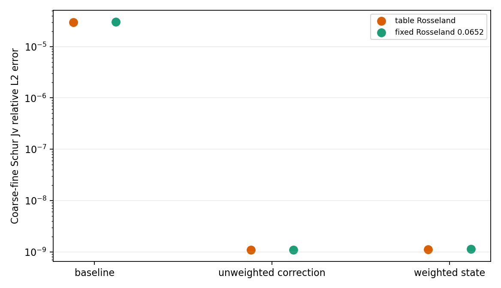

# WOR-92: source of the coarse-fine ghost tangent mismatch

Date: 2026-11-07. This follows the [coupled Schur global Jv check](wor92_coupled_global_jv_20261107.md) in isolated WOR-105-based table-EOS/Semenov builds. The original source sends a fine correction `delta_u_` to a coarse face using face-diffusion-coefficient weights and subtracts the fine tangential offset. The Newton state `u_` uses equal weights there. Two **trial-only**, environment-gated changes tested whether this difference explains the coarse-fine Jv mismatch:

1. **Unweighted correction:** disable the special weighted `delta_u_` transfer, making it use the same equal-weight path as `u_`.
2. **Weighted state:** apply the existing weighted and tangential transfer to `u_` as well as `delta_u_`.

No production source change is committed. Both flags are disabled by default, and their flag-off table runs reproduce baseline FGMRES iterations and true residuals exactly.

## Results

At cycle 0, perturbation `10^-5`, 7304 coarse-fine-adjacent cells:

| Transfer | Table-R coarse-fine Jv error | Fixed-R coarse-fine Jv error | Table-R strict result | Fixed `κR=0.0652` strict result |
|---|---:|---:|---|---|
| Baseline, weighted correction/equal-weight state | `2.98661e-5` | `3.05085e-5` | second FGMRES 300/`3.87966e-8`, fails | 3 cycles, 7/7 linear solves and Newton pass |
| Unweighted correction | `1.08544e-9` | `1.10344e-9` | second FGMRES 300/`1.90000e-7`, fails | first two linear solves pass, then Newton backtracking exhausted at cycle 0 |
| Weighted state | `1.11734e-9` | `1.14264e-9` | second FGMRES 300/`5.36452e-8`, fails | 3 cycles, 7/7 linear solves and Newton pass |

Both transfer changes remove the measured frozen-coefficient ghost tangent mismatch to the ~`10^-9` finite-difference level. The source-path difference therefore explains this diagnostic mismatch. Merely removing the correction weighting is **rejected**: it degrades the table FGMRES result and causes the formerly passing fixed-R control to exhaust Newton backtracking. The weighted-state trial preserves the short fixed-R control but does not solve the table-R strict failure; its second table residual is slightly worse than baseline. It is a possible **separate** AMR consistency change, not a verified WOR-92 solver fix. The original correction weighting may be important to the composite flux treatment; a longer conservation and physics regression is required before adopting any state-transfer change.

The two changes alter the operator and solution path, so their FGMRES counts cannot be used as a proof about a single frozen matrix. The Jv diagnostic itself freezes face coefficients, gas state and local Schur ratio. It does not test derivatives of the opacity or limiter. The table-R stopping problem remains even after coarse-fine tangent agreement improves, consistent with the uniform-grid failure and precision-floor controls.



## Reproduction and evidence

The [run CSV](wor92_transfer_consistency_results_20261107/runs.csv), [summary JSON](wor92_transfer_consistency_results_20261107/summary.json), [figure](wor92_transfer_consistency_results_20261107/transfer_jv.png), [exact inputs and logs](wor92_transfer_consistency_results_20261107/evidence.tar.gz), [unweighted-correction patch](wor92_transfer_consistency_results_20261107/unweighted_delta.patch), and [weighted-state patch](wor92_transfer_consistency_results_20261107/weighted_state.patch) capture this result. The base diagnostic binary SHA-256 is `636209373ab24c5a9f5fee803b6ac86031c23b9e1a4a62a12d691fb145de0025`; unweighted trial `a1ef90a476d8d7d0f45fdf3e723b8f35683bc84170bc04b23726f4d70d6aa33f`; weighted-state trial `2f89f9c2a52e8ce2dded3d6cbcc423587e0e7c52819af332486ea7154497b8a6`. The underlying Git base is `ebf7634a8e877edfd58724de1e3810638a76ca7e` plus the isolated, uncommitted WOR-92 trials documented in preceding reports.

Representative command from the bundle directory, with fresh output directory:

```bash
cd /home/kosuke/simulation/test/rad_nr/wor92_20261107/bundle
env ATHENA_NRFLD_CONSERVATIVE_PROTOTYPE=1 \
  ATHENA_NRFLD_CONSERVATIVE_SHARED_COEFF=1 \
  ATHENA_NRFLD_EXPERIMENTAL_TANGENTIAL_RECONSTRUCTION=1 \
  ATHENA_NRFLD_EXPERIMENTAL_VARIABLE_LIMITER=1 \
  ATHENA_NRFLD_EXPERIMENTAL_COUPLED=1 \
  ATHENA_NRFLD_EXPERIMENTAL_REGRID=1 \
  ATHENA_NRFLD_CONSERVATIVE_DIFFERENCE_JV=0 \
  ATHENA_WOR92_COUPLED_GLOBAL_JV=1 \
  ATHENA_WOR92_WEIGHTED_STATE=1 \
  timeout 150s mpirun -np 2 \
  /home/kosuke/simulation/test/rad_nr/wor92_operator_audit_20261107/build_table_weighted_state/bin/athena \
  -i /home/kosuke/simulation/test/rad_nr/wor92_wor105_retest_20261107/input_table_component_freeze_cfl030_strict_3cycles.used \
  -d /path/to/fresh/output
```

For unweighted correction, use `build_table_unweighted_delta/bin/athena` and `ATHENA_WOR92_UNWEIGHTED_DELTA=1` instead. For fixed R, set `ATHENA_WOR92_FIXED_ROSSELAND=1` and use the archived fixed-high input. Omit the transfer flag for the same-binary controls. Regenerate the data and figure with `python3 tst/nrfld_validation/wor92_transfer_consistency_20261107.py` in this worktree.

The next independent experiment is an AMR flux/conservation regression of the weighted-state transfer, plus an assembled global componentwise backward error for the unchanged table solver. WOR-92 remains **In Progress**.
