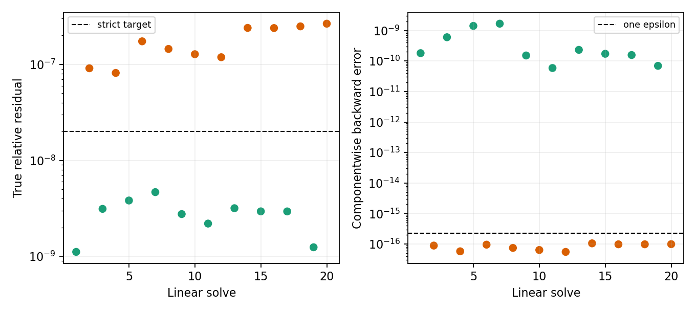

# WOR-92: one-epsilon componentwise floor on the uniform table case

Date: 2026-11-07. This is a bounded **exploratory acceptance-policy test** using the existing WOR-105-based trial binary; no source code was changed. The input has a Tomida table EoS, Semenov opacity, CFL 0.3, 32³ root fully refined to a uniform 64³ level-1 mesh, periodic radiation boundaries, and two MPI ranks. Three-cycle and ten-cycle bounds were tested. The [preceding residual study](wor92_residual_precision_20261107.md) independently confirmed the failed strict solve's true residual and found its exact global componentwise backward error to be `8.88913e-17` on this uniform geometry.

Only `fgmres_precision_floor_factor` changed from `0` (strict) to `1` (one double machine epsilon). The normwise target remained `2e-8`, maximum FGMRES iterations remained 300, and the Newton criterion was unchanged.

| Run | Linear solves | Solves accepted by one-epsilon floor | Newton-converged steps | Outcome |
|---|---:|---:|---:|---|
| Strict, floor 0 | 2 | 0 | 0 | cycle-0 second solve fails: 300 iterations, true residual `9.11880e-8` |
| One-epsilon floor | 6 | 3 | 3, each in 2 iterations | completes 3 cycles, final time `88.0851871312` code units |
| One-epsilon floor, extended | 20 | 10 | 10, each in 2 iterations | completes 10 cycles, final time `286.992977167` code units |

The first two FGMRES iteration counts and true residuals are identical in the strict and floor-1 runs, and the ten-cycle run exactly reproduces the first six solves of the three-cycle run. In the three-cycle run, the second linear solve of each cycle is accepted at 300 iterations with true residuals `9.11880e-8`, `8.15393e-8`, and `1.74032e-7`; their componentwise backward errors are `8.88913e-17`, `5.76518e-17`, and `9.52752e-17`, all below one double epsilon `2.22045e-16`. The extension reaches ten Newton-converged steps; all ten second solves need the one-epsilon floor. The largest accepted true residual is `2.65717e-7`, while the largest floor-accepted componentwise error is `1.05183e-16`. The last Newton step uses `dt=27.6026084632` code units. These are **not strict normwise passes**. Even ten uniform-grid cycles do not validate mixed AMR, later collapse stages, conservation, or a production acceptance rule.



## Reproduction

The [summary JSON](wor92_uniform_floor1_results_20261107/summary.json), [per-solve CSV](wor92_uniform_floor1_results_20261107/solves.csv), [figure](wor92_uniform_floor1_results_20261107/uniform_floor1.png), and [exact logs/inputs](wor92_uniform_floor1_results_20261107/evidence.tar.gz) record all three runs. The isolated trial binary SHA-256 is `5b259bf3c0a4b768a6a35aa9f2d9cebfd3b9151f78b80ed5583069a772ffb691`, based on Git `ebf7634a8e877edfd58724de1e3810638a76ca7e` plus previously documented uncommitted trial source. Generate artifacts with `python3 tst/nrfld_validation/wor92_uniform_floor1_20261107.py` in this report worktree.

```bash
cd /home/kosuke/simulation/test/rad_nr/wor92_20261107/bundle
env ATHENA_NRFLD_CONSERVATIVE_PROTOTYPE=1 \
  ATHENA_NRFLD_CONSERVATIVE_SHARED_COEFF=1 \
  ATHENA_NRFLD_EXPERIMENTAL_TANGENTIAL_RECONSTRUCTION=1 \
  ATHENA_NRFLD_EXPERIMENTAL_VARIABLE_LIMITER=1 \
  ATHENA_NRFLD_EXPERIMENTAL_COUPLED=1 \
  ATHENA_NRFLD_EXPERIMENTAL_REGRID=1 \
  ATHENA_NRFLD_CONSERVATIVE_DIFFERENCE_JV=0 \
  timeout 120s mpirun -np 2 \
  /home/kosuke/simulation/test/rad_nr/wor92_operator_audit_20261107/build_table_precision/bin/athena \
  -i /home/kosuke/simulation/test/rad_nr/wor92_wor105_retest_20261107/input_uniform_l1_floor1_10cycles.used \
  -d /path/to/fresh/output
```

The next required step is to expand the mixed-AMR ghost transfer into assembled global rows before using a componentwise criterion there. Then compare Newton residual, conservation, and physical fields over longer runs against a demonstrably converged reference. WOR-92 remains **In Progress**; this exploratory result does not meet the original strict linear-solver gate.
