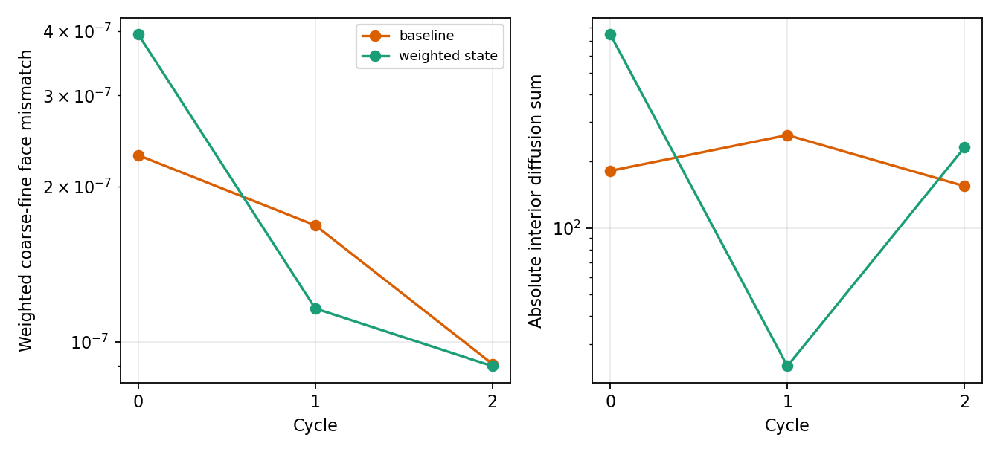

# WOR-92: complete 3D AMR flux ledger for the weighted-state transfer trial

Date: 2026-11-07. The [transfer consistency trial](wor92_transfer_consistency_20261107.md) made the coarse-fine Schur Jv diagnostic agree to ~`10^-9` by applying the existing coefficient-weighted face transfer to Newton state `u_` as well as correction `delta_u_`. It did not solve the table-R FGMRES stop. This follow-up tests whether the trial also preserves coarse-fine flux conservation in the **fixed-R, three-cycle control that converges**. Both baseline and weighted-state runs use the same Tomida/Semenov input with fixed Rosseland `κR=0.0652`, 32³ root, 120 active small-AMR blocks, two MPI ranks, CFL 0.3 and strict `2e-8` FGMRES gate.

The existing opt-in energy/interface ledgers were written directly to one file per rank. Both runs produced all 120 block records plus two energy records at each of the three stages. A 3D geometric pairing audit grouped every opposing face across x1/x2/x3, checked equal overlap area, and verified that summed internal face balances reproduce the independent domain interior diffusion ledger within `1e-3` code-energy units. The per-rank file path avoids MPI stdout record loss found in an earlier diagnostic attempt; that incomplete attempt is excluded from these results.

## Results

There are 24 coarse-fine face groups per cycle. `Weighted mismatch` is `sum |F_left+F_right| / sum (|F_left|+|F_right|)` over those groups; `max mismatch` is the largest group's relative mismatch. The `interior sum` is the domain total diffusion contribution after physical-boundary terms; zero would indicate exact cancellation of internal fluxes.

| Cycle | Baseline weighted mismatch | Weighted-state mismatch | Baseline max | Weighted-state max | Baseline interior sum | Weighted-state interior sum |
|---:|---:|---:|---:|---:|---:|---:|
| 0 | `2.299e-7` | `3.939e-7` | `5.973e-7` | `1.125e-6` | `-181.106` | `-747.321` |
| 1 | `1.682e-7` | `1.161e-7` | `5.348e-7` | `2.893e-7` | `-262.668` | `-23.822` |
| 2 | `9.070e-8` | `8.982e-8` | `4.674e-7` | `2.458e-7` | `-154.516` | `-230.850` |

Both runs completed 3 cycles and 7 strict linear solves with Newton convergence. Their FGMRES sequences exactly match the corresponding earlier runs without ledgers, so the diagnostic did not change the solver path. The weighted-state change improves the frozen Jv consistency, but its face-flux mismatch is **worse at cycle 0** and still far from roundoff in every cycle. The signed interior sum also has no consistent improvement. This trial cannot be promoted as a conservation fix. The table-R case still fails its strict linear solve, and long collapse physics is unverified. No solver source change is committed.



## Reproduction

The [per-stage CSV](wor92_weighted_state_ledger_results_20261107/stages.csv), [paired-face CSV](wor92_weighted_state_ledger_results_20261107/face_groups.csv), [summary JSON](wor92_weighted_state_ledger_results_20261107/summary.json), [figure](wor92_weighted_state_ledger_results_20261107/ledger_comparison.png), and [exact input, stdout, rank files and trial patch](wor92_weighted_state_ledger_results_20261107/evidence.tar.gz) record the audit. The baseline diagnostic binary SHA-256 is `636209373ab24c5a9f5fee803b6ac86031c23b9e1a4a62a12d691fb145de0025`; weighted-state binary SHA-256 is `2f89f9c2a52e8ce2dded3d6cbcc423587e0e7c52819af332486ea7154497b8a6`. Base Git source is `ebf7634a8e877edfd58724de1e3810638a76ca7e` plus prior isolated WOR-92 trials. Generate data and figure with `python3 tst/nrfld_validation/wor92_weighted_state_ledger_20261107.py` in this report worktree.

Run from the bundle directory with a fresh output directory and rank-log prefix:

```bash
cd /home/kosuke/simulation/test/rad_nr/wor92_20261107/bundle
env ATHENA_NRFLD_CONSERVATIVE_PROTOTYPE=1 \
  ATHENA_NRFLD_CONSERVATIVE_SHARED_COEFF=1 \
  ATHENA_NRFLD_EXPERIMENTAL_TANGENTIAL_RECONSTRUCTION=1 \
  ATHENA_NRFLD_EXPERIMENTAL_VARIABLE_LIMITER=1 \
  ATHENA_NRFLD_EXPERIMENTAL_COUPLED=1 \
  ATHENA_NRFLD_EXPERIMENTAL_REGRID=1 \
  ATHENA_NRFLD_CONSERVATIVE_DIFFERENCE_JV=0 \
  ATHENA_NRFLD_ENERGY_LEDGER=1 \
  ATHENA_NRFLD_INTERFACE_LEDGER=1 \
  ATHENA_NRFLD_RANK_LEDGER_PREFIX=/path/to/fresh/output/ledger \
  ATHENA_WOR92_FIXED_ROSSELAND=1 \
  ATHENA_WOR92_WEIGHTED_STATE=1 \
  timeout 150s mpirun -np 2 \
  /home/kosuke/simulation/test/rad_nr/wor92_operator_audit_20261107/build_table_weighted_state/bin/athena \
  -i /home/kosuke/simulation/test/rad_nr/wor92_wor105_retest_20261107/input_table_fixed_rosseland_high_cfl030_strict_3cycles.used \
  -d /path/to/fresh/output
```

For baseline, omit `ATHENA_WOR92_WEIGHTED_STATE` and use `build_table_coupled_jv/bin/athena`. The report branch contains only the audit artifacts; source trials remain in isolated copied build trees.

The next source work on this separate AMR consistency issue must seek a transfer that agrees with the Newton-state derivative **and** preserves face-flux cancellation. For the original WOR-92 stopping problem, an assembled AMR componentwise backward-error audit and better preconditioner remain open. WOR-92 remains **In Progress**.
